# Guided Discovery of New Behaviors using Diffusion Policies

Dian Yu1, Sebastian Sanokowski1, and Majid Khadiv1

1Munich Institute of Robotics and Machine Intelligence, Technical University of Munich {imdian.yu, sebastian.sanokowski, majid.khadiv}@tum.de

Abstract: Diffusion models have become a powerful tool for generative modeling in robotics, with diffusion policies excelling at modeling multimodal actiontrajectory distributions. However, when demonstrations are limited, standard sampling often reproduces dominant behaviors while neglecting valid but rare modes, limiting the discovery of novel solutions. Existing approaches, such as guidance methods or combining reinforcement learning (RL) with diffusion, either push samples into infeasible regions or struggle to escape local minima, failing to systematically uncover diverse behaviors. To address these challenges, we propose a framework that combines Feynman–Kac correctors with a novel guiding potential that systematically guides diffusion policy samples towards promising yet underrepresented samples. These trajectories are refined using sampling-based trajectory optimization and reincorporated into the training set to retrain the diffusion policy. Our method effectively mines and repairs novel trajectories, enabling the systematic discovery of diverse and executable behaviors. We demonstrate the effectiveness of our framework across a range of manipulation environments, consistently discovering new behaviors. A supplementary video is available at: youtu.be/T7MUvMA67VM.

Keywords: Diffusion Policies, Rare-Event Sampling, Motion Discovery

## 1 Introduction

Diffusion models [1, 2, 3] have emerged as one of the most powerful tools for generative modeling in robotics. In particular, diffusion policies [4] are proven to be a powerful tool for modeling multimodal action-trajectory distributions. However, under limited demonstrations, standard sampling often reproduces dominant modes while under-representing valid but rare behaviors [4]. This raises the question: How can we systematically discover new behaviors in diffusion policies?

A common approach is to use guidance methods [5] to increase sample diversity [6, 7, 8]. However, these methods often push samples into low-support regions, resulting in trajectories that are infeasible or non-executable in the environment. Alternatively, methods which combine reinforcement learning (RL) [9] with diffusion samplers [10, 11, 12], such as in [13, 14, 15], could be applied to discover new behaviors. Yet, RL and diffusion samplers are prone to getting stuck in local minima [16], making it difficult to discover diverse behaviors. Even when initialized with a pretrained policy, RL typically refines the existing policy to improve motion optimality rather than exploring new modes, unless explicit reward shaping toward new goals is used [17].

To address these limitations, we propose our framework Guided Discovery of New Behaviors (GDNB), which builds upon guidance methods while mitigating their shortcomings. GDNB is motivated by the evidence that diffusion models, which are trained in the sparse data regime, can assign low probability to useful behaviors [18, 19, 20]. Thus, we systematically guide samples using Feynman– Kac correctors [21] towards trajectories from the diffusion policy that are both promising and underrepresented samples. These frontier trajectories are then refined and corrected using sampling based trajectory optimization methods and added to the training set to retrain the diffusion policy.

Our goal is to systematically mine and repair new trajectories from the diffusion model, enabling the discovery of novel and diverse behaviors. We evaluate GDNB across diverse manipulation environments and show that it discovers executable behaviors underrepresented by the initial policy. An overview of our framework is presented in Fig. 1.

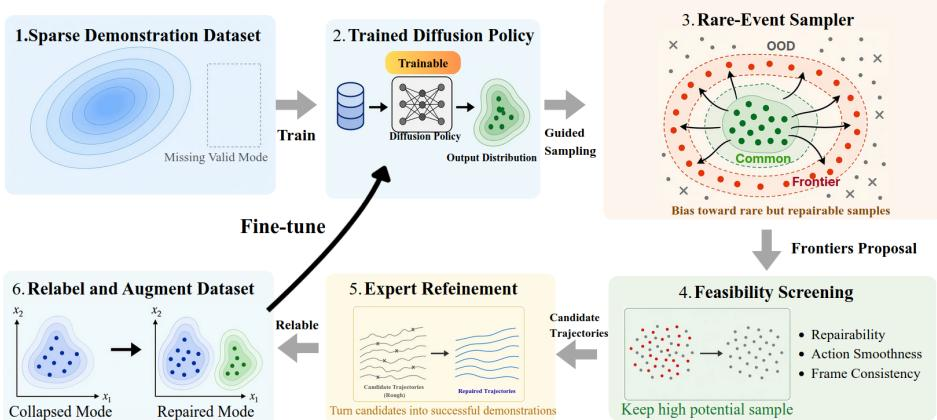  
Figure 1: Overview of the GDNB bootstrapping loop. A Rare-Event sampler proposes frontier trajectories, which are locally repaired and added back to the dataset for policy fine-tuning.

## 1.1 Related Work

Policy improvement and exploration after behavior cloning. Several recent methods aim to improve diffusion or generative policies after an imitation learning stage. Diffusion Policy Policy Optimization (DPPO) [13] extends Proximal Policy Optimization (PPO) [22] to diffusion models and [14, 15] explain how to apply diffusion models to maximum-entropy reinforcement learning. DSRL steers a frozen diffusion policy by learning in its latent-noise space [23]; SOE [24] constrains robot exploration to a learned action manifold. However, to discover diverse solutions, these methods need to be combined with skill discovery, novelty search, or reward shaping in order to encourage exploration [25, 26, 27, 17].

Synthetic demonstrations and local trajectory repair. A complementary direction is to synthesize or relabel additional demonstrations. MimicGen scales imitation datasets by adapting a small number of human demonstrations to new contexts [28], while online imitation and dataset-aggregation methods address compounding errors through additional expert or corrective data [29]. Our method instead proposes candidates from the low-support frontier of the learned policy and admits them only after environment rollout and local repair. The repair stage builds on sampling-based trajectory optimization [30], leveraging recent advances in zero-order optimization [31, 32, 33].

Guided and rare-event diffusion sampling. Inference-time guidance modifies diffusion sampling toward user-specified objectives or constraints [5]. In robotics, guided diffusion or flow-based planners use costs, generated trajectories, or safety constraints to steer samples toward feasible motion [6, 7, 8].

Rare-event diffusion sampling has also been studied in molecular modeling, where several guidance potentials are proposed, that aim at guiding the diffusion model towards rare events [34]. These methods primarily optimize sampler-side rare-region coverage or unbiased estimator recovery.

## 2 Preliminaries

We consider a sequential decision-making problem with environment time $t = 0 , \ldots , T - 1$ , state $x _ { t } \in \mathcal { X } = \mathbb { R } ^ { d _ { x } }$ , and action $a _ { t } \in \mathcal { A } = \mathbb { R } ^ { d _ { a } }$ . The environment evolves as $x _ { t + 1 } = f _ { \mathrm { d y n } } ( x _ { t } , a _ { t } )$ , with $x _ { 0 } \sim \rho _ { 0 }$ . A rollout is $\tau = ( x _ { 0 } , a _ { 0 } , \ldots , x _ { T - 1 } , a _ { T - 1 } , x _ { T } )$ . A sparse task reward $r _ { t } = r ( x _ { t } , a _ { t } , x _ { t + 1 } )$

or its rollout aggregate $R ( \tau )$ , measures task performance, and Success $( \tau ) \in \{ 0 , 1 \}$ denotes task success. In our setup, we assume access to an offline dataset of demonstrations $\dot { \mathcal { D } } = \dot { \{ \tau _ { i } \} } _ { i = 1 } ^ { N }$ , where $\tau _ { i }$ is a successful trajectory. The demonstrations capture valid strategies for solving the task, but typically represent only a sparse subset of all feasible behaviors. In practice, many environments admit multiple qualitatively different solutions that achieve high reward, yet the dataset may over-represent a few dominant modes while under-representing rare but useful behaviors.

Our goal is therefore not only to imitate the demonstrations, but to discover additional successful behaviors while remaining consistent with the environment dynamics and task constraints. Concretely, we seek to learn policies that can interact with the environment in diverse ways while still achieving the task objective.

## 2.1 Diffusion Policies

Let $A _ { t } ^ { 0 } \sim p _ { \mathrm { d a t a } } ( A _ { t } \mid x _ { t } )$ , where $A _ { t } ^ { 0 } = \left( a _ { t } , \ldots , a _ { t + H - 1 } \right) \in \mathbb { R } ^ { H \times d _ { a } }$ is an action chunk of horizon H conditioned on the current state. Diffusion policies model multimodal action distributions by learning to reverse a forward noising process that progressively perturbs $A _ { t } ^ { 0 }$ into Gaussian noise. In continuous time, this process is commonly written as a stochastic differential equation (SDE)

$$
d A _ {t} ^ {k} = g (k, A _ {t} ^ {k}) d k + b (k) d W _ {k}, \qquad k \in [ 0, 1 ],\tag{1}
$$

where $W _ { k }$ is a Wiener process in the action-chunk space $\mathbb { R } ^ { H d _ { a } } , g : [ 0 , 1 ] \times \mathbb { R } ^ { H d _ { a } } \to \mathbb { R } ^ { H d _ { a } }$ is the forward drift, $k \in [ 0 , 1 ]$ is the diffusion time step, and b : $[ 0 , 1 ] \to \mathbb { R } _ { + }$ is the diffusion coefficient. By using either a variance-preserving or variance-exploding SDE [3], the terminal reference distribution is approximately an isotropic Gaussian.

Diffusion models learn to reverse this diffusion process. With k parameterizing the reverse sampler from noise to data, the reverse-time dynamics are written as

$$
d A _ {t} ^ {k} = \left[ b (k) ^ {2} \nabla_ {A} \log p _ {k} (A _ {t} ^ {k} \mid x _ {t}) - g (k, A _ {t} ^ {k}) \right] d k + b (k)   d \bar {W} _ {k},\tag{2}
$$

where $\hat W _ { k }$ is reverse-time Brownian motion and $\nabla _ { A } \log p _ { k } ( A _ { t } ^ { k } \mid x _ { t } )$ is the conditional score. Since this score is unknown, a neural network $s _ { \theta } ^ { k } ( A _ { t } ^ { k } , x _ { t } )$ is trained to approximate it. Then, starting from Gaussian noise, repeated application of Eq. (2) generates action chunks that approximately follow the demonstrated action distribution. By repeatedly unrolling the diffusion policy in the environment, one obtains the corresponding state trajectories $X _ { 0 : T }$

For control, we use diffusion policies that generate future action sequences conditioned on the current observation. At execution time, only the first $h < H$ actions, $A _ { t , h } = ( a _ { t } , \dots , a _ { t + h - 1 } )$ , are applied before replanning. A major advantage of diffusion policies is that they naturally represent multimodal behavior distributions. However, in the low-data regime, sampling is typically dominated by highdensity modes from the demonstrations. As a result, rare but valid strategies are often assigned low probability and are rarely generated during ordinary sampling.

Guidance toward tilted distributions. A common approach to increasing diversity in diffusion model samples is guidance [5]. Guidance modifies the reverse diffusion dynamics to bias sampling toward action chunks that maximize a desired property $B ( A _ { t } , x _ { t } )$ . This can be framed as sampling from a tilted target distribution:

$$
p (A _ {t}) \propto \pi_ {\theta} (A _ {t} | x _ {t}) \exp (\beta B (A _ {t}, x _ {t})),\tag{3}
$$

which assigns low probability to regions where either $\pi _ { \boldsymbol { \theta } } ( A _ { t } | \boldsymbol { x } _ { t } )$ or $\exp ( \beta B ( A _ { t } , x _ { t } ) )$ is small, and high probability where both distributions have significant probability mass. Standard guidance methods attempt to solve this by adjusting the learned score as $\tilde { s } _ { \theta } ^ { k } ( \bar { { \cal A } } _ { t } ^ { k } , x _ { t } ) = s _ { \theta } ^ { k } ( { \cal A } _ { t } ^ { k } , \bar { { x } } _ { t } ) +$ $\beta \nabla _ { A } B _ { k } ( A _ { t } ^ { k } , x _ { t } )$ , where $\beta$ controls the guidance strength. However, this approach does not correctly sample from Eq. 3 [21] and introduces bias, potentially leading to samples with low support under $p ( A _ { t } )$ . This issue can be addressed using Feynman–Kac correctors (FKCs) [21], which provide a principled framework for steering diffusion processes (see Sec. 3.1 for more details).

## 2.2 Sampling-Based Trajectory Optimization

Sampling-based trajectory optimization (SBTO) [35] optimizes a candidate action sequence by repeatedly sampling candidate control trajectories and performing a weighted average over rollouts to improve the cost. To handle the curse of dimensionality in long-horizon problems, recent SBTO formulations [30] optimize over a sliding window of trajectories, warm-starting each segment from the solution of the previous segment. This setting is particularly effective when the optimizer tracks an imperfect reference, which is what we need in this work. In this work, we modify the SBTO in [30] to use it as a repair module (see Sec. 3.2 and App. B.1).

## 3 Method

Diffusion models trained on robotic data learn a distribution $\pi _ { \boldsymbol { \theta } } ( \tau )$ over trajectories, but in the rare data regime tend to converge toward high-probability modes representing “average” behaviors [36, 17]. In robotics this limits the discovery of diverse and novel solutions. Our method addresses this by explicitly targeting frontier samples: trajectories with low local support under the current policy-induced distribution $\pi _ { \boldsymbol { \theta } _ { r } } ( \tau )$ , but not so far from support that they become unrecoverable. Operationally, sampler-side rarity is measured by calibrated denoiser-score energy, while evaluationside rarity uses the distance-to-measure (DTM) percentile u defined in Sec. 4.2. Rare samples serve a dual purpose. First, they act as out-of-distribution probes, preventing mode collapse and ensuring the policy explores diverse behaviors across the support of $\pi _ { \boldsymbol { \theta } } ( \tau )$ . Second, they often represent novel or edge-case behaviors that the model has not yet fully learned. By mining these samples, we force exploration of under-represented state-action regions. Without explicitly targeting them, π (τ ) would continue refining high-probability behaviors rather than discovering new ones.

We propose a closed-loop bootstrapping framework that integrates the methods introduced in Sec. 2 into a cohesive pipeline, as illustrated in Fig. 1. Our iterative process consists of three key steps: (1) we guide a pretrained diffusion model toward rare samples using a Feynman–Kac corrected biasing potential; (2) a sampling-based trajectory optimization algorithm repairs the sampled rare candidates toward physical feasibility and task completion; and (3) corrected trajectories are appended to the dataset to fine-tune the diffusion policy $\pi _ { \theta }$ . This creates a targeted curriculum [37] where the model attempts unusual behaviors, receives corrective feedback, and improves. Compared to random sampling, this is more efficient as it focuses learning on the most informative, under-represented parts of the distribution. Pseudocode is provided in Algorithm 1.

## 3.1 Guidance toward rare events

A central component of our framework is the guidance function $B _ { k } ( A _ { t } ^ { k } , x _ { t } )$ , which systematically biases diffusion samples toward low-probability regions. To achieve this goal, we propose to leverage the learned score $s _ { \theta } ^ { k } ( A _ { t } ^ { k } , x _ { t } )$ ) of the diffusion model as a proxy for identifying such regions. Intuitively, samples with small score norms tend to lie in stationary, high-probability regions of the distribution. In contrast, large score norms indicate regions where the model drifts, corresponding to low-probability areas. To operationalize this, at diffusion time k we define

$$
B _ {k} (A _ {t} ^ {k}, x _ {t}) = - \Phi (d _ {\theta} ^ {k} (A _ {t} ^ {k}, x _ {t})), \qquad d _ {\theta} ^ {k} (A _ {t} ^ {k}, x _ {t}) = \| \tilde {s} _ {\theta} ^ {k} (A _ {t} ^ {k}, x _ {t}) \| _ {2} ^ {2},\tag{4}
$$

where $\tilde { s } _ { \theta } ^ { k }$ is the active score output whitened using mean and variance statistics from ordinary basepolicy rollouts at the same diffusion time. Here, Φ is inspired by the Lennard–Jones potential [38, 39]; writing $x = d / d ^ { * }$ , its shape and gradient are shown in Fig. 4. It is given by

$$
\Phi (d) = \Big (\frac {d ^ {*}}{d} \Big) ^ {p} - \frac {p}{q} \Big (\frac {d ^ {*}}{d} \Big) ^ {q} + \Big (\frac {p}{q} - 1 \Big), \quad p > q > 0.\tag{5}
$$

where $p$ and $q$ control shell sharpness, and $d ^ { * } = d _ { k } ^ { * } > 0$ is the target rare-shell energy at diffusion time $k ,$ calibrated from base-sample statistics as detailed in App. A.3.

Feynman–Kac Correctors for Tilted Target Distributions. To guide a diffusion model with a learned score $s _ { \theta }$ toward the tilted target distribution in (3), [21] propose simulating a batch of

particles according to the following SDEs:

$$
d A _ {t} ^ {k} = \left[ b _ {k} ^ {2} \left(s _ {\theta} ^ {k} (A _ {t} ^ {k}, x _ {t}) + \beta_ {k} \nabla_ {A} B _ {k} (A _ {t} ^ {k}, x _ {t})\right) - g _ {k} (A _ {t} ^ {k}) \right] d k + b _ {k} d W _ {k},\tag{6}
$$

$$
d \ell_ {k} = \left[ \partial_ {k} \beta_ {k} B _ {k} (A _ {t} ^ {k}, x _ {t}) - \langle \nabla_ {A} B _ {k} (A _ {t} ^ {k}, x _ {t}), g _ {k} (A _ {t} ^ {k}) \rangle + \left\langle \beta_ {k} \nabla_ {A} B _ {k} (A _ {t} ^ {k}, x _ {t}), \frac {b _ {k} ^ {2}}{2} s _ {\theta} ^ {k} (A _ {t} ^ {k}, x _ {t}) \right\rangle \right] d k.\tag{7}
$$

We follow the definitions from Sec. 2.1 and $\ell _ { k } = \log w _ { k }$ is the particle log-weight. After generation, particles are resampled with probabilities softmax $\mathbf { \ell } _ { : } ( \ell _ { 0 } )$ . (See App. A.4 for more details).

## 3.2 Bootstrapping Framework

Algorithm 1 Pseudocode of the Guided Discovery Framework
Require: initial dataset $\mathcal{D}_0$, reset distribution $\rho_0$, rounds $R$, number of independent initial states $N$, number of calibration samples $M$, number of rare samples $L$ $\pi_{\theta_0} \leftarrow \text{Train}(\mathcal{D}_0)$ $\triangleright$ current diffusion action policy
    for $r = 0, \ldots, R - 1$ do
        $\{x_{0,n}\}_{n=1}^N \sim \rho_0$ $\mathcal{D}_r^+ \leftarrow \{\}$
        for $n = 1, \ldots, N$ do
            $\{\tau_m^{\text{base}}\}_{m=1}^M \leftarrow \text{BaseRollout}(\pi_{\theta_r}, x_{0,n})$ $\triangleright$ Sample $M$ independent trajectories for state $x_{0,n}$ $\Gamma_{r,n} \leftarrow \text{CalibrateSampler}(\{\tau_m^{\text{base}}\}_{m=1}^M)$ $\triangleright$ compute score statistics over all $M$ trajectories
            $\{\tau_\ell^{\text{rare}}\}_{\ell=1}^L \leftarrow \text{RareRollout}(\pi_{\theta_r}, \Gamma_{r,n}, x_{0,n})$ $\triangleright$ sample $L$ rare trajectories for state $x_{0,n}$ $\{\tau_\ell^\star\}_{\ell=1}^L \leftarrow \text{SBTO}(\{\tau_\ell^{\text{rare}}\}_{\ell=1}^L, x_{0,n})$ $\triangleright$ fixed-horizon local repair
            $\mathcal{D}_r^+ \leftarrow \mathcal{D}_r^+ \cup \{\tau_\ell^\star : \text{Success}(\tau_\ell^\star) = 1, \ell = 1, \ldots, L\}$ $\triangleright$ insert successful repairs
        end for
        $\mathcal{D}_{r+1} \leftarrow \mathcal{D}_r \cup \mathcal{D}_r^+$ $\pi_{\theta_{r+1}} \leftarrow \text{FineTune}(\pi_{\theta_r}, \mathcal{D}_{r+1})$
    end for
    return $\mathcal{D}_R, \pi_{\theta_R}$

Algorithm 1 summarizes the bootstrapping loop. Starting from one of $N$ randomly sampled initial states $x _ { 0 , n } ,$ , a batch of M calibration samples is obtained from the unguided diffusion model (BaseRollout) in order to obtain calibration statistics $\Gamma _ { r , n }$ . Next, a batch of L candidates is sampled from the rare-event sampler (RareRollout) via FKC correction, and these trajectories are further refined using SBTO. Finally, successful repairs are added to $\mathcal { D } _ { r }$ , and the diffusion policy is fine-tuned for the next round.

## 4 Experiments

In our experiments, we aim to evaluate whether our framework enables a diffusion policy to learn new behaviors. To this end, we first assess in Section 4.1 whether our rare event guidance method proposed in Section 3 combined with SBTO refinement can recover missing modes in a multimodal action distribution starting from a pretrained policy. In Section 4.2, we first evaluate how our guidance potential performs in sampling rare yet in-distribution samples, comparing it against several baseline methods. Finally, we apply our full pipeline to challenging robotics manipulation benchmarks in simulation and validate the results with real-world experiments.

## 4.1 Mode Recovery in Multimodal Action Distributions

The Multimodal Agent benchmark, introduced in [15], is a multimodal RL task designed to evaluate whether diffusion-based RL policies can effectively cover multimodal action distributions in markov decision processes. In this benchmark, an agent proposes movements within a continuous range of possible directions, while the environment dynamics discretize the resulting state into one of eight fixed directional states. The initial demonstrations lie intentionally in a single-mode. Importantly, the reward landscape is bimodal for each state, with reward-equivalent optima at $a = \pm 0 . 5$ , corresponding to $\pm 4 5 ^ { \circ }$ turns. For further details, see App. C. In this work, we repurpose the Multimodal Agent benchmark to test whether, given a collapsed policy that represents only a single mode, GDNB can recover previously undiscovered modes. Our evaluation, illustrated in Figure 3, demonstrates that by leveraging the rare-event sampler introduced in Section 3.1 combined with SBTO correction, GDNB successfully recovers the missing modes on this task.

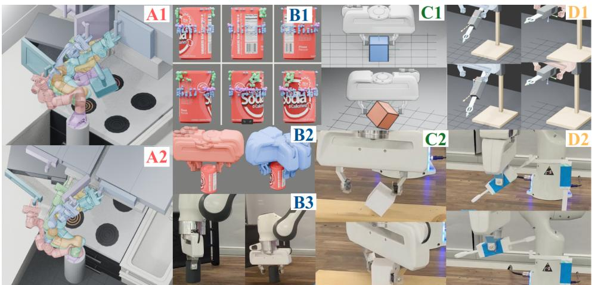  
Figure 2: Representative GDNB-discovered behaviors and real-world replay. (Blue/Cyan) denote common behaviors from the base policy, (orange/red) denote rare behaviors discovered by GDNB. Translucent robot copies indicate temporal rollout snapshots, and colored markers indicate accumulated contact locations. This figure shows key frames and contact/pose summaries. Kitchen (A1–A2): GDNB discovers rare subtask sequences, including rare successful sequences that complete at least four subtasks; here, colors indicate rollout stages rather than common-vs-rare labels. Can (B1–B3): B1 shows that GDNB discovers new gripper–can contact locations, B2 compares the corresponding common and rare end-effector grasp poses, and B3 shows a real-robot replay of the rare grasp-pose variant. Lift (C1–C2): C1 compares a common blue-box pickup with a rare orange/red-box pickup at the lifting moment, and C2 shows the corresponding real-robot replay. ToolHang (D1–D2): D1 compares a common blue-gripper release motion with a rare orange/redgripper release orientation, and D2 shows the real-robot replay of the rare release variant.

## 4.2 Rare Behavior Discovery in Robotic Manipulation

To systematically evaluate our rare event sampling potential and the discovery of new behavior, GDNB is evaluated on eight robotics manipulation benchmarks from [4]: Push-T, Block Pushing, Franka Kitchen, Lift, Can, Square, Transport, and ToolHang. The suite covers various object interactions such as planar pushing, object pushing, articulated kitchen manipulation, grasping, placement, insertion/alignment, bimanual transport, and tool hanging.

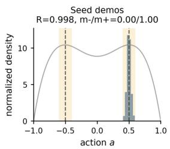

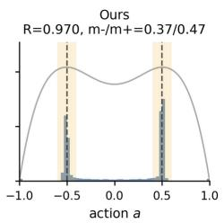  
Figure 3: Mode recovery in Multimodal Agent. Demonstrations cover only the right-turn optimum. GDNB is able to recover the probability mass of the second optimum.

## Action-space rarity sampler performance. We first evaluate the rare-event

sampler from Sec. 3.1 by analyzing generated action chunks. For each action chunk, we compute a k-nearest-neighbor (kNN) DTM score and convert it to a percentile $u \in [ 0 , 1 ]$ using held-out unmodi fied diffusion-policy samples from the same starting condition [40] (See App. A.2). Equivalently, a larger u indicates that the corresponding samples have lower base policy distribution support. We detect a sample as a frontier sample when $0 . 9 0 \leq u \leq 0 . 9 8 5$ and report it as Frontier. We report the out-of-distribution rate as $O O D = \mathrm { P r } ( u > 0 . 9 8 5 )$ and the common-sample rate as Common $= \operatorname* { P r } ( u < 0 . 9 0 )$ . Results are reported in Tab. 1, where all methods are evaluated with the same tuning budget. We include two groups of baselines. Existing sampler baselines are UmbrellaDiff, ∆G-Diff, MetaDiff [34], and Annealed FKC [21]. The uncited rows are simple internal baselines (see App. A.2):

Qualitative and real-world evaluation. We apply the full GDNB pipeline to manipulation benchmarks, illustrating new behavioral discoveries in Fig. 2. GDNB’s rare rollouts reveal coherent, taskrelevant interactions, not mere geometric deviations. The supplementary video includes all simulated rollouts and real-robot replays; Appendix D.1 provides qualitative descriptions for Push-T, Block Pushing, Square, and Transport. In Kitchen, rarity emerges at the subtask-sequence level: GDNB un-

<table><tr><td>Sampler</td><td>Frontier ↑</td><td>OOD ↓</td><td>Common ↓</td></tr><tr><td>GDNB (Ours)</td><td>59.05 ± 2.19</td><td>0.00 ± 0.00</td><td>40.95</td></tr><tr><td colspan="4">Simple internal baselines</td></tr><tr><td>Direct sampling</td><td>4.95 ± 0.38</td><td>1.05 ± 0.18</td><td>94.00</td></tr><tr><td>Best-of-K rejection</td><td>55.10 ± 1.95</td><td>8.10 ± 0.47</td><td>36.80</td></tr><tr><td>One-sided action-bank reweighting</td><td>45.57 ± 1.31</td><td>9.75 ± 0.53</td><td>44.68</td></tr><tr><td>Rare-shell Sampling</td><td>22.55 ± 0.77</td><td>3.90 ± 0.35</td><td>73.55</td></tr><tr><td colspan="4">Existing sampler baselines</td></tr><tr><td>UmbrellaDiff [34]</td><td>56.47 ± 1.99</td><td>9.88 ± 0.54</td><td>33.65</td></tr><tr><td>ΔG-Diff [34]</td><td>21.00 ± 0.86</td><td>2.50 ± 0.28</td><td>76.50</td></tr><tr><td>MetaDiff [34]</td><td>16.25 ± 0.35</td><td>3.98 ± 0.15</td><td>79.77</td></tr><tr><td>Annealed FKC [21]</td><td>9.45 ± 0.47</td><td>1.48 ± 0.18</td><td>89.07</td></tr></table>

Table 1: Action-space rarity sampler performance. Rarity is measured by the base-calibrated kNN-DTM percentile u on whitened diffusion action chunks. Values are percentages. Reported ± values are standard errors.

covers uncommon subtask orders, including rare successful sequences completing at least four subtasks (appearing in ∼ 1% of the original distribution). Panels A1–A2 show rendered Kitchen rollouts from different viewpoints. In Can, GDNB discovers a distinct grasp-and-release strategy: the gripper contacts the can at novel locations (B1) and approaches with a different end-effector orientation (B2), with B3 showing the real-robot replay. In Lift, GDNB finds a flip-then-grasp pickup: the end effector flips the cube into a new orientation before grasping (bottom row of C1), with C2 showing the real-robot replay. In ToolHang, GDNB discovers a rare mid-air release mode, where the robot releases the tool toward the hook mid-air (right of D1), replayed on the real robot in D2. These examples demonstrate GDNB’s ability to expose structured interactions: subtask ordering, object-local contact, end-effector pose at contact time, object reorientation before grasping, and release timing/orientation. Physical replays confirm executability of selected Can, Lift, and ToolHang motions beyond simulation: after calibrating end-effector–object geometry to match simulation, we replay trajectories open loop on the real robot, recomputing joint-space commands via inverse kinematics to address physical base height and workspace differences.

Quantitative evaluation. We quantitatively evaluate discovered rollouts using physically interpretable task-related event measures, such as contact geometry, object motion, approach or release pose, handoff geometry, timing, and subtask order. The full list of event measures is provided in App. D. These events describe the contact geometry, object motion, approach or release pose, handoff geometry, timing, and subtask order. We then compare the resulting sample distributions using Kernel Density Estimation (KDE) [41]. We compute two KDE-based metrics. The Task Feature KDE is estimated directly on the scalar event value extracted from the rollout. This metric measures how the rollout distribution shifts or spreads along a physically interpretable event dimension. The Task Rareness KDE is computed based on a rareness score $s _ { a } ( \tau ) \in [ 0 , 1 ]$ (see App. D), where larger values denote events that are rarer under the original policy. Axis definitions, score families, and KDE construction are given in App. D; Task-feature distribution-shift diagnostics are shown in App. D.5. Table 2 reports success and selected KDE summary scores. Feature bal. balances retained task-feature density and breadth; DV bal. balances outside-base density and variance; Memory, Novel gain, and Support denote retained base density, added rare-tail density, and total successful support in rareness space. ± denotes standard deviation over the eight benchmarks; (more details in App. E).

Baseline Comparison. We compare against five baseline methods that aim to improve or expand a behavior-cloned diffusion policy after initial training: policy-gradient fine-tuning (DPPO [13]), modal level self-improvement (SIME [42]), on-manifold exploration (SOE [24]), synthetic demonstration

generation (MimicGen [28]), and latent-noise steering of a frozen diffusion policy (DSRL [23]). All baselines start from the same pretrained diffusion policy or demonstrations, use the same benchmark reset states, and environment success/reward signals. Implementation details are given in App. E.1. We also include three internal framework ablations in the same table: direct rollout of the pretrained checkpoint, GDNB without the rare sampler, and GDNB without SBTO. These rows isolate whether distributional expansion comes from the rare-guided sampler and whether the repair stage is needed to turn rare drafts into reliable executable data.

<table><tr><td rowspan="2">Method</td><td rowspan="2">Success ↑</td><td colspan="2">Task Feature KDE</td><td colspan="3">Task Rareness KDE</td></tr><tr><td>Feature bal. ↑</td><td>DV bal. ↑</td><td>Memory ↑</td><td>Novel gain ↑</td><td>Support ↑</td></tr><tr><td>GDNB (Ours)</td><td> $0.883 \pm 0.257$ </td><td> $0.664 \pm 0.189$ </td><td> $0.308 \pm 0.131$ </td><td> $0.813 \pm 0.158$ </td><td> $0.100 \pm 0.150$ </td><td> $0.582 \pm 0.232$ </td></tr><tr><td>DPPO [13]</td><td> $0.796 \pm 0.277$ </td><td> $0.503 \pm 0.310$ </td><td> $0.276 \pm 0.209$ </td><td> $0.689 \pm 0.223$ </td><td> $0.069 \pm 0.088$ </td><td> $0.483 \pm 0.240$ </td></tr><tr><td>SIME [42]</td><td> $0.752 \pm 0.291$ </td><td> $0.660 \pm 0.238$ </td><td> $0.262 \pm 0.145$ </td><td> $0.923 \pm 0.054$ </td><td> $0.033 \pm 0.037$ </td><td> $0.555 \pm 0.257$ </td></tr><tr><td>SOE [24]</td><td> $0.760 \pm 0.272$ </td><td> $0.661 \pm 0.228$ </td><td> $0.216 \pm 0.127$ </td><td> $0.927 \pm 0.088$ </td><td> $0.020 \pm 0.025$ </td><td> $0.524 \pm 0.238$ </td></tr><tr><td>MimicGen [28]</td><td> $0.751 \pm 0.283$ </td><td> $0.640 \pm 0.202$ </td><td> $0.246 \pm 0.139$ </td><td> $0.855 \pm 0.181$ </td><td> $0.027 \pm 0.034$ </td><td> $0.528 \pm 0.226$ </td></tr><tr><td>DSRL [23]</td><td> $0.744 \pm 0.283$ </td><td> $0.679 \pm 0.215$ </td><td> $0.238 \pm 0.159$ </td><td> $0.903 \pm 0.093$ </td><td> $0.022 \pm 0.025$ </td><td> $0.534 \pm 0.232$ </td></tr><tr><td>Pretrained checkpoint</td><td> $0.779 \pm 0.141$ </td><td> $0.656 \pm 0.223$ </td><td> $0.244 \pm 0.159$ </td><td> $0.893 \pm 0.056$ </td><td> $0.065 \pm 0.053$ </td><td> $0.408 \pm 0.081$ </td></tr><tr><td>w/o rare sampler</td><td> $0.857 \pm 0.104$ </td><td> $0.153 \pm 0.084$ </td><td> $0.100 \pm 0.034$ </td><td> $0.804 \pm 0.057$ </td><td> $0.067 \pm 0.054$ </td><td> $0.536 \pm 0.072$ </td></tr><tr><td>w/o SBTO</td><td> $0.778 \pm 0.094$ </td><td> $0.265 \pm 0.091$ </td><td> $0.102 \pm 0.034$ </td><td> $0.709 \pm 0.085$ </td><td> $0.042 \pm 0.105$ </td><td> $0.512 \pm 0.106$ </td></tr></table>

DV = density–variance.  
Table 2: Policy quality under Task Feature KDE and Task Rareness KDE. Task Feature KDE evaluates successful rollout density on task-feature coordinates. Task Rareness KDE evaluates successful rollout density on base-calibrated rareness scores. All KDE metrics are scaled to [0, 1].

A comparison in Table 2 shows that GDNB achieves the highest success rate, the strongest Task Feature density–variance score, and the largest Task Rareness novel gain and support. DSRL attains the highest Feature balanced score and SOE has the highest Memory, but both add less successful rareness-tail density and achieve lower task success. Overall, GDNB gives the strongest combined profile across execution, task-feature expansion, and rareness-score expansion.

Continuation across rare-mining rounds. The GDNB pipeline can be applied for several rounds of iterations. Thus, we repeat the whole pipeline on the fine-tuned policy on Can, ToolHang, and Transport, where we continue to observe novel behavior without a success-rate drop. On Can, we observe new contact/release points; on ToolHang, we observe new approach/contact variations. Transport mostly preserves the first-round rare behaviors, with smaller changes in right-hand approach, handoff timing, and contact pose. App. F reports the consecutive-round distribution metrics.

## 5 Limitations

We did not fully characterize the long-term behavior of our GDNB framework. Specifically, it remains unclear whether, after many iterations, the method begins to saturate, either by failing to discover new behaviors or by producing samples via rare guidance that are no longer repairable by SBTO. Second, GDNB requires careful tuning of both the SBTO optimizer and the biasing-potential hyperparameters. Finally, our strategy of adding newly discovered trajectories into the training dataset might not scale well to a large number of GDNB iterations. Thus, it would be useful to add filters that only keep the most important and diverse samples or to combine our method with continual learning [43] methods. Other interesting directions for future work are to study round-wise saturation and automatic parameter selection.

## 6 Conclusion

In this work, we present GDNB, a bootstrapping framework for discovering new executable behaviors in diffusion policies. GDNB uses Feynman–Kac sampling with a biasing potential that systematically guides samples into lower probability regions. A sampling-based optimization algorithm then filters and repairs these samples through rollouts in simulation. Successfully repaired samples are added to the training set, and the diffusion policy is fine-tuned on the extended dataset. Our experiments show that GDNB is able to recover missing modes in a multimodal action space. Across manipulation benchmarks we observe the emergence of new behaviors. Representative real-world replays further confirm that the discovered motions are physically executable.

## References

[1] J. Sohl-Dickstein, E. Weiss, N. Maheswaranathan, and S. Ganguli. Deep unsupervised learning using nonequilibrium thermodynamics. In International conference on machine learning, pages 2256–2265. pmlr, 2015.

[2] J. Ho, A. Jain, and P. Abbeel. Denoising diffusion probabilistic models. Advances in neural information processing systems, 33:6840–6851, 2020.

[3] Y. Song, J. Sohl-Dickstein, D. P. Kingma, A. Kumar, S. Ermon, and B. Poole. Score-based generative modeling through stochastic differential equations. In International Conference on Learning Representations, 2021. URL https://openreview.net/forum?id=PxTIG12RRH S.

[4] C. Chi, Z. Xu, S. Feng, E. Cousineau, Y. Du, B. Burchfiel, R. Tedrake, and S. Song. Diffusion policy: Visuomotor policy learning via action diffusion. The International Journal of Robotics Research, 44(10-11):1684–1704, 2025.

[5] J. Ho and T. Salimans. Classifier-free diffusion guidance, 2022. URL https://arxiv.org/ abs/2207.12598.

[6] K. Saha, V. Mandadi, J. Reddy, A. Srikanth, A. Agarwal, B. Sen, A. Singh, and M. Krishna. Edmp: Ensemble-of-costs-guided diffusion for motion planning. In 2024 IEEE International Conference on Robotics and Automation (ICRA), pages 10351–10358. IEEE, 2024.

[7] S. Fan, Q. Yang, Y. Liu, K. Wu, Z. Che, Q. Liu, and M. Wan. Diffusion trajectory-guided policy for long-horizon robot manipulation. IEEE Robotics and Automation Letters, 10(12): 12788–12795, 2025. doi:10.1109/LRA.2025.3619794. URL https://doi.org/10.1109/ LRA.2025.3619794.

[8] X. Dai, Z. Yang, D. Yu, F. Liu, H. Sadeghian, S. Haddadin, and S. Hirche. Safeflow: Safe robot motion planning with flow matching via control barrier functions. arXiv preprint arXiv:2504.08661, 2025.

[9] R. S. Sutton and A. G. Barto. Reinforcement learning - an introduction. Adaptive computation and machine learning. MIT Press, 1998. ISBN 978-0-262-19398-6. URL http://www.inco mpleteideas.net/book/first/the-book.html.

[10] Q. Zhang and Y. Chen. Path integral sampler: A stochastic control approach for sampling. In International Conference on Learning Representations, 2022. URL https://openreview.n et/forum?id=\_uCb2ynRu7Y.

[11] J. Berner, L. Richter, and K. Ullrich. An optimal control perspective on diffusion-based generative modeling. Transactions on Machine Learning Research, 2024. ISSN 2835-8856. URL https://openreview.net/forum?id=oYIjw37pTP.

[12] S. Sanokowski, L. Gruber, C. Bartmann, S. Hochreiter, and S. Lehner. Rethinking losses for diffusion bridge samplers. In The Thirty-ninth Annual Conference on Neural Information Processing Systems, 2026. URL https://openreview.net/forum?id=O58KDUfB4x.

[13] A. Ren, J. Lidard, L. Ankile, A. Simeonov, P. Agrawal, A. Majumdar, B. Burchfiel, H. Dai, and M. Simchowitz. Diffusion policy policy optimization. In International Conference on Learning Representations, 2025.

[14] O. Celik, Z. Li, D. Blessing, G. Li, D. Palenicek, J. Peters, G. Chalvatzaki, and G. Neumann. DIME: Diffusion-based maximum entropy reinforcement learning. In A. Singh, M. Fazel, D. Hsu, S. Lacoste-Julien, F. Berkenkamp, T. Maharaj, K. Wagstaff, and J. Zhu, editors, Proceedings of the 42nd International Conference on Machine Learning, volume 267 of Proceedings of Machine Learning Research, pages 6958–6977. PMLR, 13–19 Jul 2025. URL https://proceedings.mlr.press/v267/celik25a.html.

[15] S. Sanokowski and K. Patil. Diffusion-augmented markov decision processes for maximum entropy reinforcement learning. arXiv preprint arXiv:2512.02019, 2025.

[16] J. He, Y. Du, F. Vargas, D. Zhang, S. Padhy, R. OuYang, C. Gomes, and J. M. Hernandez-Lobato.´ No trick, no treat: Pursuits and challenges towards simulation-free training of neural samplers. arXiv preprint arXiv:2502.06685, 2025.

[17] A. Longhini, D. Emukpere, J.-M. Renders, and S. Kim. Behavioral mode discovery for finetuning multimodal generative policies, 2026. URL https://arxiv.org/abs/2605.11387.

[18] X. Gu, C. Du, T. Pang, C. Li, M. Lin, and Y. Wang. On memorization in diffusion models. Transactions on Machine Learning Research, 2025. ISSN 2835-8856. URL https://openre view.net/forum?id=D3DBqvSDbj. Accepted by TMLR.

[19] C. He, X. Liu, G. M. S. Camps, J. Bruno, G. A. Sartoretti, and M. Schwager. Demystifying robot diffusion policies: Action memorization and a simple lookup table alternative. In The Fourteenth International Conference on Learning Representations, 2026. URL https: //openreview.net/forum?id=PL0tJOfm7I.

[20] Z. Kadkhodaie, F. Guth, E. P. Simoncelli, and S. Mallat. Generalization in diffusion models arises from geometry-adaptive harmonic representations. In The Twelfth International Conference on Learning Representations, 2024. URL https://openreview.net/forum?id=ANvm VS2Yr0.

[21] M. Skreta, T. Akhound-Sadegh, V. Ohanesian, R. Bondesan, A. Aspuru-Guzik, A. Doucet, R. Brekelmans, A. Tong, and K. Neklyudov. Feynman-kac correctors in diffusion: Annealing, guidance, and product of experts. In A. Singh, M. Fazel, D. Hsu, S. Lacoste-Julien, F. Berkenkamp, T. Maharaj, K. Wagstaff, and J. Zhu, editors, Proceedings of the 42nd International Conference on Machine Learning, volume 267 of Proceedings of Machine Learning Research, pages 55906–55949. PMLR, 13–19 Jul 2025. URL https: //proceedings.mlr.press/v267/skreta25a.html.

[22] J. Schulman, F. Wolski, P. Dhariwal, A. Radford, and O. Klimov. Proximal policy optimization algorithms. arXiv preprint arXiv:1707.06347, 2017.

[23] A. Wagenmaker, Y. Zhang, M. Nakamoto, S. Park, W. Yagoub, A. Nagabandi, A. Gupta, and S. Levine. Steering your diffusion policy with latent space reinforcement learning. In J. Lim, S. Song, and H.-W. Park, editors, Proceedings of The 9th Conference on Robot Learning, volume 305 of Proceedings of Machine Learning Research, pages 258–282. PMLR, 27–30 Sep 2025. URL https://proceedings.mlr.press/v305/wagenmaker25a.html.

[24] Y. Jin, J. Lv, H. Xue, W. Chen, C. Wen, and C. Lu. Soe: Sample-efficient robot policy self-improvement via on-manifold exploration. arXiv preprint arXiv:2509.19292, 2025.

[25] B. Eysenbach, A. Gupta, J. Ibarz, and S. Levine. Diversity is all you need: Learning skills without a reward function. arXiv preprint arXiv:1802.06070, 2018.

[26] R. Devidze, P. Kamalaruban, and A. Singla. Exploration-guided reward shaping for reinforcement learning under sparse rewards. In S. Koyejo, S. Mohamed, A. Agarwal, D. Belgrave, K. Cho, and A. Oh, editors, Advances in Neural Information Processing Systems, volume 35, pages 5829–5842. Curran Associates, Inc., 2022. URL https://proceedings.neurips.cc /paper\_files/paper/2022/file/266c0f191b04cbbbe529016d0edc847e-Paper-Con ference.pdf.

[27] J. Lehman and K. O. Stanley. Novelty Search and the Problem with Objectives, pages 37–56. Springer New York, New York, NY, 2011. ISBN 978-1-4614-1770-5. doi:10.1007/978-1-461 4-1770-5 3. URL https://doi.org/10.1007/978-1-4614-1770-5\_3.

[28] A. Mandlekar, S. Nasiriany, B. Wen, I. Akinola, Y. Narang, L. Fan, Y. Zhu, and D. Fox. Mimicgen: A data generation system for scalable robot learning using human demonstrations. In J. Tan, M. Toussaint, and K. Darvish, editors, Proceedings of The 7th Conference on Robot Learning, volume 229 of Proceedings of Machine Learning Research, pages 1820–1864. PMLR, 06–09 Nov 2023. URL https://proceedings.mlr.press/v229/mandlekar23a.html.

[29] S. Ross, G. Gordon, and D. Bagnell. A reduction of imitation learning and structured prediction to no-regret online learning. In G. Gordon, D. Dunson, and M. Dud´ık, editors, Proceedings of the Fourteenth International Conference on Artificial Intelligence and Statistics, volume 15 of Proceedings of Machine Learning Research, pages 627–635, Fort Lauderdale, FL, USA, 11–13 Apr 2011. PMLR. URL https://proceedings.mlr.press/v15/ross11a.html.

[30] V. Dhedin, I. Taouil, S. Omar, D. Yu, K. Tao, A. Dai, and M. Khadiv. Dynaretarget: Dynamically-feasible retargeting using sampling-based trajectory optimization. arXiv preprint arXiv:2602.06827, 2026.

[31] M. Kobilarov. Cross-entropy motion planning. The International Journal of Robotics Research, 31(7):855–871, 2012.

[32] C. Pinneri, S. Sawant, S. Blaes, J. Achterhold, J. Stueckler, M. Rolinek, and G. Martius. Sample-efficient cross-entropy method for real-time planning. In J. Kober, F. Ramos, and C. Tomlin, editors, Proceedings of the 2020 Conference on Robot Learning, volume 155 of Proceedings of Machine Learning Research, pages 1049–1065. PMLR, 16–18 Nov 2021. URL https://proceedings.mlr.press/v155/pinneri21a.html.

[33] G. Williams, A. Aldrich, and E. A. Theodorou. Model predictive path integral control: From theory to parallel computation. Journal of Guidance, Control, and Dynamics, 40(2):344–357, 2017.

[34] Y. Xie, L. Winkler, L. Sun, S. Lewis, A. E. Foster, J. J. Luna, T. Hempel, M. Gastegger, Y. Chen, I. Zaporozhets, et al. Enhanced diffusion sampling: Efficient rare event sampling and free energy calculation with diffusion models. arXiv preprint arXiv:2602.16634, 2026.

[35] V. Kurtz. Hydrax: Sampling-based model predictive control on gpu with jax and mujoco mjx, 2024. https://github.com/vincekurtz/hydrax.

[36] K. Rana, R. Lee, D. Pershouse, and N. Suenderhauf. IMLE Policy: Fast and Sample Efficient Visuomotor Policy Learning via Implicit Maximum Likelihood Estimation. In Proceedings of Robotics: Science and Systems, LosAngeles, CA, USA, June 2025. doi:10.15607/RSS.2025. XXI.158.

[37] Y. Bengio, J. Louradour, R. Collobert, and J. Weston. Curriculum learning. In Proceedings of the 26th annual international conference on machine learning, pages 41–48, 2009.

[38] G. Mie. Zur kinetischen theorie der einatomigen korper.¨ Annalen der Physik, 316(8):657–697, 1903. doi:https://doi.org/10.1002/andp.19033160802. URL https://onlinelibrary.wile y.com/doi/abs/10.1002/andp.19033160802.

[39] R. J. Sadus. Second virial coefficient properties of the nm lennard-jones/mie potential. The Journal of Chemical Physics, 149(7), 2018. doi:10.1063/1.5041320.

[40] F. Chazal, D. Cohen-Steiner, and Q. Merigot. Geometric inference for probability measures.´ Foundations of Computational Mathematics, 11(6):733–751, 2011.

[41] M. Rosenblatt. Remarks on some nonparametric estimates of a density function. The Annals of Mathematical Statistics, 27(3):832–837, 1956.

[42] Y. Jin, J. Lv, W. Yu, H. Fang, Y.-L. Li, and C. Lu. Sime: Enhancing policy self-improvement with modal-level exploration. In 2025 IEEE/RSJ International Conference on Intelligent Robots and Systems (IROS), pages 9792–9799. IEEE, 2025.

[43] J. Kirkpatrick, R. Pascanu, N. Rabinowitz, J. Veness, G. Desjardins, A. A. Rusu, K. Milan, J. Quan, T. Ramalho, A. Grabska-Barwinska, et al. Overcoming catastrophic forgetting in neural networks. Proceedings of the national academy of sciences, 114(13):3521–3526, 2017.

[44] X. Gu, L. Akoglu, and A. Rinaldo. Statistical analysis of nearest neighbor methods for anomaly detection. Advances in Neural Information Processing Systems, 32, 2019.

[45] J. T. Barron. A general and adaptive robust loss function. In Proceedings of the IEEE/CVF Conference on Computer Vision and Pattern Recognition (CVPR), June 2019.

## A Sampler Details

This appendix gives sampler-side derivations and implementation details omitted from the main method. In this sampler appendix only, t denotes diffusion/reverse time; environment time is not used in the sampler derivations. App. A.1 explains the predicted-noise rarity coordinate used by the rare-event sampler. App. A.2 defines the action-space DTM percentile used in Tab. 1 and summarizes the action-bank ablation variants. App. A.3 records the complementary rare-shell potential used by the diffusion sampler. App. A.4 derives the Euler–Maruyama Feynman–Kac weight update used in implementation. Except for the post-hoc action-space DTM coordinate, quantities in this section are defined in denoising coordinates and do not define a task-space interest region or a rollout-side frontier gate.

## A.1 Gaussian-Reference Scale for Denoiser-Score Energy

This appendix gives the reference calculation behind the denoiser-score energy $d _ { \theta } ^ { t }$ used by the sampler in Sec. 3.1. The calculation is used only to put the sampler-side energy on a stable scale. It is not a claim that diffusion-policy trajectories are globally Gaussian, nor that the resulting statistic is a calibrated likelihood, task-space novelty score, or standalone OOD detector.

Let

$$
\tilde {s} _ {\theta} ^ {t} (y, c) = \frac {P _ {\mathrm{act}} \epsilon_ {\theta} (y , t , c) - \mu_ {t} ^ {s}}{\sigma_ {t} ^ {s} + \varepsilon_ {\mathrm{std}}} \in \mathbb {R} ^ {d _ {\mathrm{eff}}}
$$

be the whitened active denoiser-score proxy at reverse time t, where $P _ { \mathrm { a c t } }$ removes padded or inactive denoiser-output coordinates. The sampler-side calibration bank in Algorithm 1 provides time-dependent statistics $\mu _ { t } ^ { s } , \sigma _ { t } ^ { s }$ , fitted from ordinary policy traces. The energy and standardized coordinate are

$$
d _ {\theta} ^ {t} (y, c) = \| \tilde {s} _ {\theta} ^ {t} (y, c) \| _ {2} ^ {2}, \qquad z _ {t} (y, c) = \frac {d _ {\theta} ^ {t} (y , c) - d _ {\mathrm{eff}}}{\sqrt {2 d _ {\mathrm{eff}}}}.\tag{8}
$$

The whitening is a calibration step for denoiser-score proxy features across reverse time. It is not a density model.

Bayes denoising identity. Under the standard ϵ-prediction objective, the population-optimal full predicted-noise vector satisfies

$$
\epsilon_ {\theta} ^ {\star , \mathrm{full}} (y, t, c) = \mathbb {E} [ \epsilon \mid Y _ {t} = y, c ] = - \bar {\sigma} _ {t} \nabla_ {y} \log p _ {t} (y \mid c),\tag{9}
$$

on the coordinates of the Gaussian corruption process. Projecting to the active coordinates gives

$$
h _ {t} ^ {\star} (y, c) = P _ {\mathrm{act}} \epsilon_ {\theta} ^ {\star , \mathrm{full}} (y, t, c) = - \bar {\sigma} _ {t} P _ {\mathrm{act}} \nabla_ {y} \log p _ {t} (y \mid c).\tag{10}
$$

Thus, the active predicted-noise output is proportional to the active conditional score; after whitening, it is the implementation of the main-text proxy $\tilde { s } _ { \theta } ^ { t }$ , whose squared norm is $d _ { \theta } ^ { t }$

Reference scale. If the active whitened coordinates were locally close to independent standard Gaussian residuals, then $d _ { \theta } ^ { t }$ would have mean $d _ { \mathrm { e f f } }$ and variance $2 d _ { \mathrm { e f f } }$ . This motivates the standardized coordinate in Eq. (8). In practice, the policy distribution can be sparse, multimodal, and anisotropic, so the global distribution of $d _ { \theta } ^ { t }$ need not be $\chi ^ { 2 }$ . We therefore use $z _ { t }$ only as a proposal-side coordinate for constructing the complementary potential. Whether a sampled action becomes data is decided later by forward rollout, local refinement, and acceptance.

## A.2 Action-Space kNN-DTM Percentiles and Action-Bank Variants

Tab. 1 uses an action-space rarity coordinate computed separately for each starting condition. The coordinate is based on DTM, a robust distance-like construction for probability measures [40]. Nearest-neighbor DTM scores have also been studied as anomaly scores with finite-sample guarantees [44]. We use this score only as a calibrated local rarity proxy over action chunks, not as a global likelihood estimator.

For a fixed starting condition s, the base action bank contains action chunks in $\mathbb { R } ^ { N _ { \mathrm { b a n k } } \times H \times d _ { a } }$ , which we flatten to $x _ { i } \in \mathbb { R } ^ { H d _ { c } }$ a . Whitening is fitted per starting condition using train-split robust statistics: median centering and MAD scaling, with a standard-deviation fallback for nearly constant coordinates. We use a 70% train split as the reference bank $\mathcal { R } _ { s }$ and the remaining split for calibration. For a whitened query ${ \tilde { x } } ,$ the empirical kNN-DTM score is

$$
d _ {k} (\tilde {x}; \mathcal {R} _ {s}) = \left[ \frac {1}{k} \sum_ {i = 1} ^ {k} \| \tilde {x} - \mathrm{NN} _ {i} (\tilde {x}; \mathcal {R} _ {s}) \| _ {2} ^ {2} \right] ^ {1 / 2}, \qquad k = 1 0.
$$

The held-out calibration split converts this score into a percentile

$$
u (x) = \widehat {F} _ {\mathrm{cal}, s} \big (d _ {k} (\tilde {x}; \mathcal {R} _ {s}) \big).
$$

Thus, larger u means that the candidate action chunk lies farther from the direct-policy action bank for the same starting condition. The frontier interval used in Tab. 1 is $0 . 9 0 \leq u \leq 0 . 9 8 5$ . The OOD column reports $\operatorname* { P r } ( u > 0 . 9 8 5 )$ .

Action-bank variants. The uncited sampler rows in Tab. 1 are internal action-bank ablations. They operate on an already generated action bank and do not modify the diffusion reverse dynamics. For completeness, we also include GDNB’s ranking rule in the last row. All values in Tab. 1 are aggregated over multiple experimental runs and multiple independently sampled starting conditions; the reported means and standard errors are computed over this multi-start evaluation pool.

Paper row Mathematical idea
Best-of-K rejection Post-hoc best-of-bank selection. At each step, draw K = 50 available bank candidates and keep the one closest to the target band  $0.90 \leq u \leq 0.985$ .
One-sided action-bank reweighting Weighted sampling without replacement with  $w(u) \propto \exp\{5 \text{ sigmoid}((u - 0.90)/0.03)\}$ . This reduces common samples but does not explicitly penalize u &gt; 0.985.
Rare-shell Sampling Weighted sampling without replacement with an LJ-like shell weight  $w(u) \propto \exp[-3 V_{\mathrm{LJ}}(u; 0.975)]$ , soft-capped at 10. This is a soft preference, not a hard frontier filter.
GDNB row Frontier-first ranking: candidates inside  $0.90 \leq u \leq 0.985$  are prioritized, common candidates are considered next, and u &gt; 0.985 OOD candidates are placed last. The LJ shell value is used as a secondary score.

Table 3: Action-bank sampler variants described with paper-facing names only.

The key distinction is that Rare-shell Sampling and GDNB both use an LJ-shaped rarity preference, but only GDNB adds the hard frontier-first/OOD-last ordering. This ordering explains why the GDNB row obtains high frontier coverage while keeping the OOD rate at zero in Tab. 1. Rare-shell Sampling targets a higher shell percentile, $u _ { \star } = 0 . 9 7 5$ , but because it is only stochastic weighted sampling, it can still select many common samples and some OOD samples.

## A.3 Complementary Rare-Shell Potential

The main method uses a bounded rare-shell potential in denoiser-score energy. Given a target standardized level $z _ { \star } .$ , the corresponding target rare-shell energy in the main-text notation is

$$
d _ {t} ^ {\star} = d _ {\mathrm{eff}} + \sqrt {2 d _ {\mathrm{eff}}} z _ {\star}.\tag{11}
$$

Dropping the conditioning variable c for readability, use the calibrated energy $d _ { \theta } ^ { t } ( y , c )$ from Eq. (8). We define the normalized score-energy coordinate

$$
x _ {t} (y, c) = \frac {d _ {\theta} ^ {t} (y , c) + \varepsilon_ {E}}{d _ {t} ^ {\star} + \varepsilon_ {E}}.\tag{12}
$$

Here $\varepsilon _ { E } > 0$ is a small numerical stabilizer. The value $x _ { t } ( y , c )$ ≈ 1 corresponds to the target rare shell. Values below one have lower calibrated denoiser-score energy than the target, and values above one have higher calibrated denoiser-score energy. We do not interpret this ordering as a global likelihood ordering.

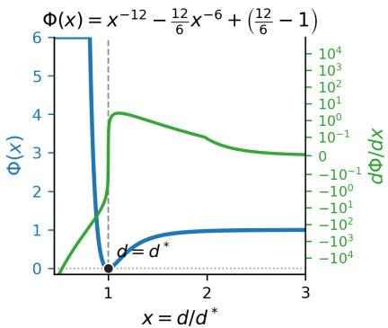

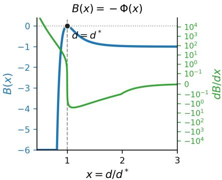  
Figure 4: Lennard-Jones-like rare-shell potential. We visualize the normalized score-energy coordinate $x = d / d ^ { * }$ . The shell cost $\Phi ( x ) = \bar { x } ^ { - 1 2 } - 2 x ^ { - 6 } + 1$ is minimized at $x = 1$ , corresponding to the target rare shell $d = d ^ { * }$ . The reward bias $B ( x ) = - \Phi ( x )$ therefore attracts samples toward this shell instead of monotonically pushing them toward increasingly large score norms. Green curves show the corresponding derivatives, which determine the guidance direction.

The shell cost used in the main experiments is

$$
C _ {t} (y) = \gamma_ {t} \operatorname{cap} _ {v _ {\max}} \left[ x _ {t} (y) ^ {- p} - \frac {p}{q} x _ {t} (y) ^ {- q} + \left(\frac {p}{q} - 1\right) \right], \qquad p > q > 0.\tag{13}
$$

The uncapped term has its minimum at $x _ { t } = 1$ , so $C _ { t }$ is minimized at the target shell. We absorb the guidance strength into this time-dependent cost. In the main-text notation, the complete bias entering the tilted target is $\beta _ { t } B _ { t } ( y ) = - C _ { t } ( y )$

Activation window. The scalar schedule $\gamma _ { t } \in [ 0 , \infty )$ both scales the bias and activates it only on selected reverse-time intervals. This prevents the bias from over-constraining the highest-noise phase and avoids over-editing the final denoising steps. All variants below use the same guided Euler–Maruyama proposal and FKC correction; only the scalar cost $C _ { t }$ changes.

One-sided denoiser-energy potential. For ablations, we also use a one-sided complementary cost:

$$
C _ {t} ^ {\mathrm{one}} (y) = \gamma_ {t} \mathrm{softplus} (- \kappa z _ {t} (y) + \tau_ {z}).\tag{14}
$$

Here $\kappa > 0$ controls the softplus slope, and $\tau _ { z }$ is a scalar offset for the standardized coordinate $z _ { t }$ . This version suppresses common low- $\mathbf { - } _ { z _ { t } }$ particles but does not explicitly discourage particles from moving beyond a target shell. In the main-text notation, the corresponding complete bias satisfies $\beta _ { t } B _ { t } ^ { \mathrm { o n e } } ( y ) = - C _ { t } ^ { \mathrm { o n e } } ( y )$

## A.4 Euler–Maruyama Feynman–Kac Weights

This appendix derives the discrete weight update used by the rare-event sampler. The derivation is carried out directly on the Euler–Maruyama path space used in implementation. This avoids continuous-time divergence, Hessian-trace, or Laplacian estimates.

Let

$$
Y _ {k} := Y _ {t _ {k}}, \qquad \Delta t _ {k} = t _ {k + 1} - t _ {k}, \qquad b _ {k} := b _ {t _ {k}}, \qquad C _ {k} := C _ {t _ {k}} (Y _ {k}), \qquad \eta_ {k} := \nabla_ {y} C _ {t _ {k}} (Y _ {k}).
$$

Here $C _ { t } ( y ) : = - \beta _ { t } B _ { t } ( y )$ denotes the complete nonnegative shell cost used by the Euler–Maruyama proposal, including the time-dependent guidance strength. Thus $\exp [ - C _ { t } ( y ) ] \ : = \ : \exp [ \beta _ { t } B _ { t } ( y ) ]$ matching the tilted-target convention used in Sec. 3.1.

The unguided Euler–Maruyama target kernel follows the main-text reverse-time drift,

$$
p _ {k} (Y _ {k + 1} \mid Y _ {k}) = \mathcal {N} \left(Y _ {k + 1}; Y _ {k} + \left[ b _ {k} ^ {2} s _ {\theta} ^ {t _ {k}} (Y _ {k}, c) - g (t _ {k}, Y _ {k}) \right] \Delta t _ {k}, b _ {k} ^ {2} \Delta t _ {k} I\right).\tag{15}
$$

The guided proposal kernel is

$$
q _ {k} ^ {C} (Y _ {k + 1} \mid Y _ {k}) = \mathcal {N} \left(Y _ {k + 1}; Y _ {k} + \left[ b _ {k} ^ {2} s _ {\theta} ^ {t _ {k}} (Y _ {k}, c) - g (t _ {k}, Y _ {k}) - b _ {k} ^ {2} \eta_ {k} \right] \Delta t _ {k}, b _ {k} ^ {2} \Delta t _ {k} I\right),\tag{16}
$$

where the proposal drift is the main-text unguided reverse-time drift plus the cost-gradient correction,

$$
b _ {k} ^ {2} s _ {\theta} ^ {t _ {k}} (Y _ {k}, c) - g (t _ {k}, Y _ {k}) - b _ {k} ^ {2} \eta_ {k}.\tag{17}
$$

Equivalently, a proposal sample can be written as

$$
Y _ {k + 1} = Y _ {k} + \left[ b _ {k} ^ {2} s _ {\theta} ^ {t _ {k}} (Y _ {k}, c) - g (t _ {k}, Y _ {k}) - b _ {k} ^ {2} \eta_ {k} \right] \Delta t _ {k} + b _ {k} \sqrt {\Delta t _ {k}} \xi_ {k}, \quad \xi_ {k} \sim \mathcal {N} (0, I).\tag{18}
$$

The unnormalized tilted density at time $t _ { k }$ contains the factor exp $[ - C _ { t _ { k } } ( Y _ { k } ) ] = \exp [ \beta _ { t _ { k } } B _ { t _ { k } } ( Y _ { k } ) ]$ under the main-text convention $C _ { t } = - \beta _ { t } B _ { t }$ . The incremental log-weight is therefore

$$
\ell_ {k + 1} - \ell_ {k} = - (C _ {k + 1} - C _ {k}) + \log \frac {p _ {k} (Y _ {k + 1} \mid Y _ {k})}{q _ {k} ^ {C} (Y _ {k + 1} \mid Y _ {k})}, \quad \ell_ {k} := \log w _ {k}.\tag{19}
$$

Since the two kernels are Gaussians with equal covariance, the ratio is explicit.

Using Eq. (18),

$$
Y _ {k + 1} - \left(Y _ {k} + \left[ b _ {k} ^ {2} s _ {\theta} ^ {t _ {k}} (Y _ {k}, c) - g (t _ {k}, Y _ {k}) - b _ {k} ^ {2} \eta_ {k} \right] \Delta t _ {k}\right) = b _ {k} \sqrt {\Delta t _ {k}} \xi_ {k},\tag{20}
$$

whereas relative to the unguided mean,

$$
Y _ {k + 1} - \left(Y _ {k} + \left[ b _ {k} ^ {2} s _ {\theta} ^ {t _ {k}} (Y _ {k}, c) - g (t _ {k}, Y _ {k}) \right] \Delta t _ {k}\right) = b _ {k} \sqrt {\Delta t _ {k}} \xi_ {k} - b _ {k} ^ {2} \Delta t _ {k} \eta_ {k}.\tag{21}
$$

Substitution into the Gaussian log-density ratio gives

$$
\log \frac {p _ {k} (Y _ {k + 1} \mid Y _ {k})}{q _ {k} ^ {C} (Y _ {k + 1} \mid Y _ {k})} = - \frac {1}{2} b _ {k} ^ {2} \Delta t _ {k} \| \eta_ {k} \| _ {2} ^ {2} + b _ {k} \sqrt {\Delta t _ {k}} \langle \eta_ {k}, \xi_ {k} \rangle .\tag{22}
$$

Combining Eq. (19) and Eq. (22) yields

$$
\ell_ {k + 1} = \ell_ {k} - (C _ {k + 1} - C _ {k}) - \frac {1}{2} b _ {k} ^ {2} \Delta t _ {k} \| \eta_ {k} \| _ {2} ^ {2} + b _ {k} \sqrt {\Delta t _ {k}} \langle \eta_ {k}, \xi_ {k} \rangle .\tag{23}
$$

This correction is exact for the chosen Euler–Maruyama Gaussian kernels. It is not a claim that the continuous-time guided drift alone exactly realizes the tilted marginals.

Resampling. Weights are normalized within each particle batch. For normalized weights $\tilde { w } _ { i } ,$ , we use the Kish effective sample size

$$
\mathrm{ESS} = \frac {1}{\sum_ {i} \tilde {w} _ {i} ^ {2}}.\tag{24}
$$

Sequential Monte Carlo (SMC) resampling is triggered when ESS falls below a fixed threshold during denoising. After any intermediate resampling, particle weights are reset uniformly. At the final reverse step, the returned particle is selected according to

$$
\Pr (i) = \frac {\exp (\ell_ {0 , i})}{\sum_ {j} \exp (\ell_ {0 , j})} = \operatorname{softmax} (\ell_ {0}) _ {i},\tag{25}
$$

which matches the main-text description.

## B Local Repair and Policy Adaptation

This appendix expands the non-sampling operators in Algorithm 1. These components do not define the rare region. SBTO tests whether each sampled rare draft can be locally refined into a successful trajectory; the adaptation objective specifies how accepted repairs are mixed with rehearsal data.

## B.1 SBTO Implementation: Frontier-Preserving Local Repair

In GDNB, SBTO denotes the local repair operator applied after rare-candidate generation. This operator does not define the rare region and is not used as a planner from scratch. Instead, it receives a diffusion-sampled draft action sequence and tests whether the draft can be converted into a successful, executable rollout through bounded local edits. We call this implementation frontier-preserving because its trust-region and regularization terms are designed to keep the repaired trajectory close to the sampled draft while correcting local failures.

Relation to prior SBTO formulations. The repair module follows the standard SBTO recipe of sampling candidate trajectories in a lower-dimensional knot space, rolling them out in simulation, and updating the sampling distribution using an elite set [30]. The use case, however, differs from DynaRetarget [30]. DynaRetarget is designed for dynamically feasible retargeting and uses an incremental horizon strategy to solve progressively longer problems. In contrast, our SBTO instance optimizes a fixed-horizon window around a sampled diffusion-policy draft. Its objective is not to track an external kinematic reference as closely as possible, but to preserve the draft’s frontier behavior while making the rollout successful and executable.

Knot representation and local trust region. Let

$$
A ^ {0} = (a _ {0} ^ {0}, \dots , a _ {T - 1} ^ {0}) \in \mathbb {R} ^ {T \times d _ {a}}
$$

be a rare-candidate draft action sequence, with initial state $x _ { 0 }$ and task context c. We downsample the draft to $N _ { k }$ action knots and reconstruct full actions by interpolation:

$$
K ^ {0} = \Pi (A ^ {0}), \qquad A (K) = \mathcal {I} (K).\tag{26}
$$

The search is restricted to a local trust region around the draft knots:

$$
\mathcal {T} _ {m} (K ^ {0}) = \left\{K: \| D _ {K} ^ {- 1} (K _ {i} - K _ {i} ^ {0}) \| _ {\infty} \leq \rho_ {K} ^ {(m)}, \quad i = 1, \dots , N _ {k} \right\},\tag{27}
$$

where $D _ { K }$ scales the action channels and $\rho _ { K } ^ { ( m ) }$ is the trust-region radius at Cross-Entropy Method (CEM) iteration $m .$ . In practice, $\rho _ { K } ^ { ( m ) }$ can be warmed up from a small initial radius to the full radius. This makes early iterations conservative and prevents the optimizer from immediately leaving the sampled draft.

For each candidate K, the simulator executes

$$
\tau (K) = \text {Rollout} (x _ {0}, A (K), c).\tag{28}
$$

We denote the draft rollout by $\tau ^ { 0 } = \tau ( K ^ { 0 } )$

Repair objective. SBTO minimizes a rollout-based repair objective

$$
\begin{array}{r l} & J _ {\mathrm{FP-SBTO}} (K) = J _ {\mathrm{task}} (\tau (K)) + \lambda_ {\mathrm{track}} J _ {\mathrm{track}} (A (K), A ^ {0}, \tau (K), \tau^ {0}) \\ & \qquad + \lambda_ {\mathrm{rs}} J _ {\mathrm{res-smooth}} (A (K), A ^ {0}) + \lambda_ {\mathrm{knot}} J _ {\mathrm{knot}} (K, K ^ {0}) \\ & \qquad + \gamma_ {\mathrm{succ}} (\tau (K)) [ \lambda_ {\mathrm{sparse}} J _ {\mathrm{sparse}} (A (K), A ^ {0}) + \lambda_ {\mathrm{cap}} J _ {\mathrm{cap}} (A (K), A ^ {0}) ]. \end{array}\tag{29}
$$

The first line encourages task completion while keeping the repaired trajectory close to the draft. The second line discourages high-frequency residual edits and large knot displacement. The final line is a success-gated sparse-edit penalty: once a candidate is close to succeeding, unnecessary edits are penalized more strongly.

A typical task term is

$$
J _ {\mathrm{task}} (\tau) = - R _ {\mathrm{task}} (\tau) + \lambda_ {\mathrm{fail}} \mathbf {1} [ \mathrm{Success} (\tau) = 0 ],\tag{30}
$$

where $R _ { \mathrm { t a s k } }$ is the environment reward or rollout score.

Draft tracking and residual smoothness. The tracking term collects task-specific local preservation costs, such as action tracking, end-effector tracking, gripper timing, action-bound penalties, or task-visible descriptor preservation:

$$
J _ {\mathrm{track}} = J _ {\mathrm{act}} + J _ {\mathrm{eef}} + J _ {\mathrm{grip}} + J _ {\mathrm{bound}} + J _ {\mathrm{desc}}.\tag{31}
$$

Not all terms are used in every task backend; Eq. (31) summarizes the common interface.

Let the residual action edit be

$$
\delta a _ {t} = a _ {t} - a _ {t} ^ {0}.
$$

We penalize high-frequency residual edits rather than over-smoothing the whole candidate action sequence:

$$
J _ {\mathrm{res-smooth}} (A, A ^ {0}) = \frac {1}{T - 2} \sum_ {t = 0} ^ {T - 3} \left\| D _ {a} ^ {- 1} \big (\delta a _ {t + 2} - 2 \delta a _ {t + 1} + \delta a _ {t} \big) \right\| _ {2} ^ {2}.\tag{32}
$$

The knot prior is

$$
J _ {\mathrm{knot}} (K, K ^ {0}) = \frac {1}{N _ {k}} \sum_ {i = 1} ^ {N _ {k}} \| D _ {K} ^ {- 1} (K _ {i} - K _ {i} ^ {0}) \| _ {2} ^ {2}.\tag{33}
$$

Frame-sparse Welsch edit penalty. A central difference from a purely quadratic edit penalty is the frame-sparse edit regularizer based on the Welsch/Leclerc robust loss [45]. Define the normalized per-frame edit magnitude

$$
g _ {t} (A, A ^ {0}) = \| D _ {a} ^ {- 1} (a _ {t} - a _ {t} ^ {0}) \| _ {2}.\tag{34}
$$

The Welsch penalty is

$$
\rho_ {W} (g; \sigma_ {\mathrm{W}}) = 1 - \exp \left(- \frac {g ^ {2}}{2 \sigma_ {\mathrm{W}} ^ {2}}\right),\tag{35}
$$

and the sparse-edit cost is

$$
J _ {\mathrm{sparse}} (A, A ^ {0}) = \frac {1}{T} \sum_ {t = 0} ^ {T - 1} \rho_ {W} (g _ {t} (A, A ^ {0}); \sigma_ {\mathrm{W}}).\tag{36}
$$

Because $\rho _ { W }$ saturates for large $g _ { t }$ , this term behaves like a soft count of edited frames. It discourages repairs that spread small changes across many frames, while allowing a small number of critical frames to change substantially when needed for success.

We optionally add a soft cap on the number of edited frames:

$$
N _ {\mathrm{edit}} (A, A ^ {0}) = \sum_ {t = 0} ^ {T - 1} \rho_ {W} (g _ {t} (A, A ^ {0}); \sigma_ {\mathrm{W}}), \qquad J _ {\mathrm{cap}} = \mathrm{softplus} \left(\frac {N _ {\mathrm{edit}} - N _ {\mathrm{cap}}}{\tau_ {\mathrm{cap}}}\right) ^ {2}.\tag{37}
$$

Success-gated edit regularization. The sparse-edit regularizer is most useful after the optimizer has found a nearly successful candidate. We therefore gate it by a smooth success score:

$$
\gamma_ {\mathrm{succ}} (\tau) = \mathrm{sigmoid} \left(\frac {R _ {\mathrm{max}} (\tau) - R _ {\mathrm{gate}}}{\tau_ {\mathrm{gate}}}\right),\tag{38}
$$

where $R _ { \mathrm { m a x } } ( \tau )$ is the maximum rollout reward or task progress score. When a candidate is far from success, CEM mainly optimizes the task objective. Once the candidate becomes close to success, the Welsch sparse-edit and edit-cap terms discourage unnecessary deformation of the draft.

CEM update and fallback. At CEM iteration m, SBTO samples knot candidates from a Gaussian distribution, projects them into the trust region in Eq. (27), rolls them out, and selects the elite set ${ \mathcal { E } } _ { m }$ with lowest $J _ { \mathrm { F P - S B T O } }$ . The sampling distribution is updated by

$$
\mu_ {m + 1} = (1 - \alpha_ {\mu}) \mu_ {m} + \alpha_ {\mu} \frac {1}{| \mathcal {E} _ {m} |} \sum_ {K \in \mathcal {E} _ {m}} \operatorname{vec} (K),\tag{39}
$$

$$
\Sigma_ {m + 1} = (1 - \alpha_ {\Sigma}) \Sigma_ {m} + \alpha_ {\Sigma} \operatorname{Cov} \left(\{\operatorname{vec} (K): K \in \mathcal {E} _ {m} \}\right) + \epsilon_ {\Sigma} I.\tag{40}
$$

The best candidate over all CEM iterations is returned. If the optimized candidate does not improve the repair objective over the draft, the backend falls back to the draft. Thus optimization is allowed to fail without forcing a large off-draft motion into the dataset.

Acceptance. In the implementation used for the main experiments, insertion into the dataset uses environment success as the hard acceptance condition:

$$
\mathrm{Accept} (\tau^ {\star}) = \mathbf {1} [ \mathrm{Success} (\tau^ {\star}) = 1 ].\tag{41}
$$

Locality is enforced before this decision by the trust region, knot prior, tracking terms, Welsch sparse-edit penalty, and fallback. Rarity is not used as a post-repair hard acceptance gate. This separation is intentional: the sampler proposes rare candidates, while SBTO only tests whether each rare-candidate draft can be locally repaired into a successful trajectory.

## B.2 Retention-Regularized Adaptation

This appendix expands the fine-tuning step in Algorithm 1. Let $\mathcal { D } _ { r } ^ { + }$ be the accepted repaired trajectories after achieved-outcome relabeling, and let $\mathcal { D } _ { \mathrm { r e h } } ^ { ( r ) } \subset \mathcal { D } _ { r }$ be a matched rehearsal set. For an observation $^ { O , }$ action trajectory A, condition $c ,$ diffusion time t, and Gaussian noise $\epsilon \sim \mathcal { N } ( 0 , I )$ define

$$
Y _ {t} = \sqrt {\bar {\alpha} _ {t}} A + \sqrt {1 - \bar {\alpha} _ {t}} \epsilon .\tag{42}
$$

The accepted repairs are trained with the standard denoising loss

$$
\mathcal {L} _ {+} (\theta) = \mathbb {E} _ {\mathcal {D} _ {r} ^ {+}, t, \epsilon} \left[ \| \epsilon - \epsilon_ {\theta} (Y _ {t}, t, o, c) \| _ {2} ^ {2} \right],\tag{43}
$$

and rehearsal data are trained with

$$
\mathcal {L} _ {\mathrm{reh}} (\theta) = \mathbb {E} _ {\mathcal {D} _ {\mathrm{reh}} ^ {(r)}, t, \epsilon} \left[ \| \epsilon - \epsilon_ {\theta} (Y _ {t}, t, o, c) \| _ {2} ^ {2} \right].\tag{44}
$$

When retention regularization is used, the previous checkpoint $\theta _ { r }$ is frozen and the adapted denoiser is anchored on rehearsal states:

$$
\mathcal {L} _ {\mathrm{KD}} (\theta ; \theta_ {r}) = \mathbb {E} _ {\mathcal {D} _ {\mathrm{reh}} ^ {(r)}, t, \epsilon} \left[ \| \epsilon_ {\theta} (Y _ {t}, t, o, c) - \mathrm{sg} [ \epsilon_ {\theta_ {r}} (Y _ {t}, t, o, c) ] \| _ {2} ^ {2} \right].\tag{45}
$$

The adaptation objective is

$$
\theta_ {r + 1} = \arg \min _ {\theta} \mathcal {L} _ {+} (\theta) + \lambda_ {\mathrm{reh}} \mathcal {L} _ {\mathrm{reh}} (\theta) + \lambda_ {\mathrm{KD}} \mathcal {L} _ {\mathrm{KD}} (\theta ; \theta_ {r}) + \lambda_ {\mathrm{anchor}} \| \theta - \theta_ {r} \| _ {2} ^ {2}.\tag{46}
$$

The rehearsal and distillation terms reduce drift on previously supported behaviors while the accepted repairs introduce new support.

## C Multimodal Agent protocol details

Multimodal Agent [15] uses heading observations

$$
o _ {t} = [ \cos \theta_ {t}, \sin \theta_ {t} ]
$$

and scalar actions $a _ { t } \in [ - 1 , 1 ]$ . The reward landscape has two symmetric optimal action modes at $a = - 0 . 5$ and $a = + 0 . 5$ . We use this task as a controlled support-recovery diagnostic: the initial data cover all heading conditions but contain demonstrations from only one action mode.

Seed distribution. The seed demonstrations are deliberately one-sided. Headings are sampled from the eight supported conditions

$$
\theta \in \{- 1 8 0 ^ {\circ}, - 1 3 5 ^ {\circ}, - 9 0 ^ {\circ}, - 4 5 ^ {\circ}, 0 ^ {\circ}, 4 5 ^ {\circ}, 9 0 ^ {\circ}, 1 3 5 ^ {\circ} \},
$$

and the observation is the corresponding heading embedding [cos θ, sin θ]. Actions are sampled only near the right-turn optimum $a = + 0 . 5$ , with small Gaussian perturbations and clipping to $[ - 1 , 1 ]$ Thus the seed dataset is condition-diverse in observations but single-mode in actions. Across the five random seeds used in our runs, this corresponds to 960 one-sided seed demonstrations.

Toy-task bootstrapping protocol. In this toy environment, we replace the robot repair module with a simple reward-curve selector. Candidate actions are generated by the sampler, ranked by the native reward curve, and the top 20% are inserted back into the training set together with rehearsal samples. The sampler itself does not access the reward curve. This isolates whether sampling and reinsertion can create support for a missing reward-equivalent mode, rather than whether a trajectory optimizer can solve a manipulation task.

Metrics. We report average per-step return $\bar { R }$ and left/right mode masses

$$
m _ {-} = \Pr (| a + 0. 5 | \leq 0. 1), \quad m _ {+} = \Pr (| a - 0. 5 | \leq 0. 1).\tag{47}
$$

Since the missing mode is $a = - 0 . 5$ , the primary support-recovery diagnostic is $m _ { - }$ . We also report mode balance

$$
B _ {\mathrm{mode}} = 1 - \frac {| m _ {+} - m _ {-} |}{m _ {+} + m _ {-} + \varepsilon},\tag{48}
$$

which is near zero for a single-mode policy and near one for a balanced two-mode policy. These quantities are support diagnostics; the main purpose of this task is qualitative mode-recovery analysis rather than a scalar-return benchmark.

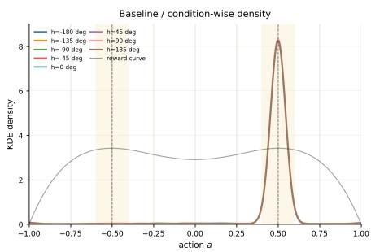

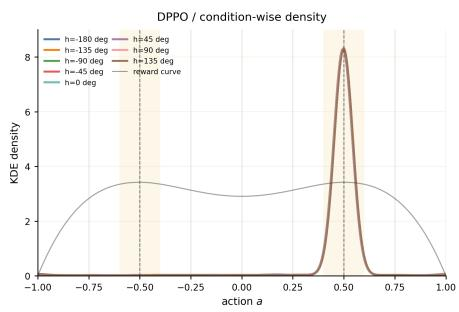

(a) Baseline / seed-trained policy  
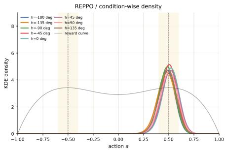  
(c) REPPO

(b) DPPO  
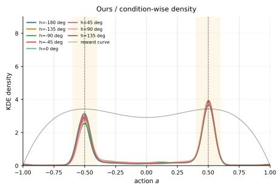  
(d) GDNB (Ours)  
Figure 5: Condition-wise action densities on Multimodal Agent. Each colored curve is the KDE of sampled actions for one heading condition. The gray curve shows the bimodal reward landscape, and the shaded bands mark the two reward-equivalent optima at $a = - 0 . 5$ and $a = + 0 . 5$ . The seed-trained baseline is concentrated on the right mode. DPPO preserves the same collapse. REPPO broadens the density around the right well but still does not create a separate left-mode peak. GDNB recovers visible probability mass near the missing left mode while retaining the original right mode.

Figure 5 shows why this benchmark is a support-recovery test rather than a standard rewardimprovement test. Because both $a = - 0 . 5$ and $a = + 0 . 5$ are reward-optimal, a policy can obtain high return while remaining collapsed onto the seed-supported right mode. The baseline in Fig. 5a and DPPO in Fig. 5b remain sharply concentrated near $a = + 0 . 5$ . REPPO in Fig. 5c increases variance around the same right-mode region, but it still does not form a distinct density peak at $a = - 0 . 5$ . In contrast, GDNB in Fig. 5d recovers a second peak near the missing left mode while preserving mass near the original right mode. The qualitative conclusion is therefore support expansion: native-reward fine-tuning baselines remain essentially single-mode, whereas rare-guided bootstrapping exposes and reincorporates the absent reward-equivalent mode.

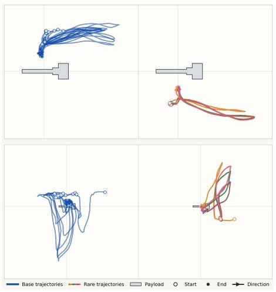  
(a) Transport

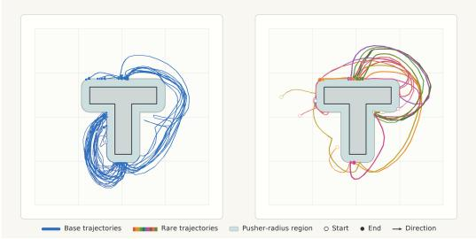  
(b) Push-T

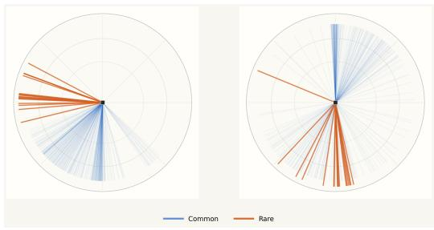  
(c) Block Pushing  
Figure 6: Qualitative rare-case diagnostics for remaining benchmarks. (a) End-effector-center trajectories for two phases of Transport, with common rollouts in the left column and rare rollouts in the right column. (b) Base and rare pusher-center trajectories around the T-shaped block in Push-T. (c) Box-frame angle diagnostics for Block Pushing: first-contact angle on the left and post-contact push direction on the right.

## D Task-related Rare Events and KDE Protocol

This appendix defines the task-related event measures used in Experiment 2. These axes are posthoc evaluation coordinates. They are not used by the rare-event sampler, the repair optimizer, the fine-tuning loss, or baseline selection.

## D.1 Qualitative rare-case descriptions for remaining benchmarks

This subsection complements the main qualitative panels in Fig. 2 by describing the remaining manip ulation benchmarks. The descriptions are not additional filtering rules: they are visual interpretations of the same discovered rollout families used for the task-related event measures in Tab. 4.

Transport. Fig. 6(a) visualizes end-effector-center trajectories for two representative phases of the bimanual transport task, with common rollouts shown in the left column and rare rollouts shown in the right column. The first row tracks the left end-effector as it approaches the hammer-shaped payload before lift, ending at the left-clamp proxy. The second row tracks the right end-effector as it approaches the payload while the left end-effector is already holding it, ending at the handoff proxy. Compared with the compact common trajectories, the rare rollouts exhibit different approach corridors and handoff geometries. These differences indicate a task-level behavioral change: GDNB alters the spatial coordination between the two arms during clamp and handoff, rather than merely adding small perturbations to the marginal trajectory of a single end-effector.

Push-T. Fig. 6(b) visualizes the pusher-center trajectories around the T-shaped object. The base policy concentrates on a narrow family of motions around the commonly used side of the T and repeatedly approaches similar contact neighborhoods. The rare rollouts found by GDNB instead wrap around the object with broad arcs, often reaching the upper shoulder or the opposite side of the T before applying contact. This pattern is physically meaningful because planar pushing is highly sensitive to where the pusher contacts the object: changing the side and angle of contact changes the induced rotation and translation of the T. The rare trajectories therefore correspond to alternative contact sequences for manipulating the same object, rather than to arbitrary geometric perturbations of the base path.

Block Pushing. Fig. 6(c) shows two angle distributions expressed in the coordinate frame of the box. The left polar plot measures the angle at which the agent first contacts the box, while the right polar plot measures the direction of the subsequent push after contact. Common rollouts occupy the dominant box-frame sectors in blue, whereas rare rollouts concentrate in orange sectors that are only weakly represented by the base policy. The resulting rare behavior is a change in contact mechanics: GDNB discovers side-biased contacts and post-contact pushes from less common boxrelative directions. These modes are useful because the same object displacement can be achieved through different contact faces and force directions, and the rare distribution exposes those alternatives explicitly.

Square. In Square, the most salient rare behavior is a stable try–fail–retry insertion pattern. Instead of executing a single monotone approach and insertion, rare rollouts first attempt to align the object with the square peg or goal, encounter a partial-contact failure such as a misalignment or blocked insertion, retreat or reorient locally, and then attempt the insertion again. This recovery-like sequence is rare under the base policy, which more often follows a direct approach mode. The pattern is physically meaningful because contact-rich insertion tasks frequently require local correction after the first contact; discovering such retry behavior adds a qualitatively different recovery strategy rather than merely adding path noise.

## D.2 Task-feature and rareness-score coordinates

For each task-related event $^ { a , }$ let $f _ { a } ( \tau )$ be the rollout descriptor vector. We summarize each event with two complementary scalar coordinates: a physically interpretable task-feature coordinate $x _ { a } ( \tau )$ and a base-calibrated rareness score $s _ { a } ( \tau )$

Task Feature KDE. Task Feature KDE uses a one-dimensional task-feature coordinate

$$
x _ {a} (\tau) = \rho_ {a}   v _ {a} ^ {\top} W _ {a} \big (f _ {a} (\tau) - \mu_ {a} \big), \qquad \rho_ {a} \in \{- 1, + 1 \}.\tag{49}
$$

The whitening statistics $( \mu _ { a } , W _ { a } )$ are fitted on base rollouts. The vector $v _ { a }$ is the event-axis projection direction, and $\rho _ { a }$ orients the axis so that larger values correspond to the rarer side of the base rollout bank. KDEs are computed directly on $x _ { a } ( \tau )$

<table><tr><td>Benchmark</td><td>Rare events</td><td>Benchmark</td><td>Rare events</td></tr><tr><td>Push-T</td><td>contact dynamics; block progress; contact timing</td><td>Block Pushing</td><td>block contact mode; contact path; block motion trajectory</td></tr><tr><td>Franka Kitchen</td><td>attempt order; success order</td><td>Lift</td><td>contact timing; short-horizon box motion; box-end-effector contact point</td></tr><tr><td>Can</td><td>can-local contact geometry; contact end-effector pose; release end-effector pose</td><td>Square</td><td>end-effector trajectory; object-goal contact dynamics; peg-insert motion</td></tr><tr><td>Transport</td><td>bimanual pre-approach; gripper contact mode; handoff geometry</td><td>ToolHang</td><td>pre-hook approach; grasp/hook contact; gripper-tool contact mode</td></tr></table>

Table 4: Task-related rare events in manipulation benchmarks: Semantic rollout descriptors used for post-hoc rare-behavior evaluation. Task-feature coordinates are defined below; the full descriptor-to-score-family mapping is given in Table 5.

Task Rareness KDE. Task Rareness KDE uses a base-calibrated rareness score $s _ { a } ( \tau ) \in [ 0 , 1 ]$ Depending on the event, $s _ { a }$ is computed by kNN-DTM percentile, robust-distance percentile, raw percentile, or task-interest anchor percentile.

For kNN-DTM axes, we use

$$
d _ {k, a} (\tau) = \left[ \frac {1}{k} \sum_ {v \in \mathrm{NN} _ {k} (\tilde {f} _ {a} (\tau); \mathcal {V} _ {a})} \| \tilde {f} _ {a} (\tau) - v \| _ {2} ^ {2} \right] ^ {1 / 2}, \qquad s _ {a} (\tau) = \widehat {F} _ {\mathrm{cal}, a} \big (d _ {k, a} (\tau) \big),\tag{50}
$$

where $\tilde { f } _ { a }$ is the whitened event feature, $\gamma _ { a }$ is the base reference split, and $\widehat { F } _ { \mathrm { c a l } , a }$ is the empirical CDF on the base calibration split.

For Kitchen, attempt-order and success-order are discrete subtask-order descriptors. KDE is applied only after mapping these descriptors to scalar base-calibrated feature/rareness coordinates, so the curves should be interpreted as smoothed empirical summaries rather than densities over raw sequence labels. The separate true-success-sequence diagnostic is categorical and is analyzed by sequence frequencies rather than continuous KDE.

## D.3 KDE protocol

For both KDE views, density-based metrics use success-only rollouts. For method m and axis a, let $\hat { p } _ { m , a } ^ { F , + }$ be the success-only KDE on the Task Feature coordinate $x _ { a }$ , and let $\hat { p } _ { m , a } ^ { R , + }$ be the success-only KDE on the Task Rareness coordinate $s _ { a } .$ . KDEs are evaluated on a fixed one-dimensional grid using a Gaussian kernel and are normalized to unit area on the grid. Metrics are computed per axis, averaged within each benchmark, and then averaged across the eight benchmarks.

Task Feature KDE reports feature retention, feature breadth, feature balanced, base-density affinity, outside-base mass, outside-base variance, outside-base evenness, outside-base diversity, and density– variance balanced. Task Rareness KDE reports Memory, Novel gain, Support, and Rare recall.

## D.4 Task event measures and score families

Table 5: Task event descriptors used by Task Feature KDE and Task Rareness KDE. Task Feature KDE uses the listed event descriptor as its task-feature coordinate. Task Rareness KDE uses the listed base-calibrated score family.

<table><tr><td>Task</td><td>Event descriptor</td><td>Task Rareness score family</td></tr><tr><td>Can</td><td>Can-local fingertip contact geometry</td><td>task-specific local feature percentile</td></tr><tr><td>Can</td><td>contact end-effector pose</td><td>task-specific local feature percentile</td></tr><tr><td>Can</td><td>release end-effector pose</td><td>task-specific local feature percentile</td></tr><tr><td>Lift</td><td>box-end-effector contact point</td><td>robust-distance percentile</td></tr><tr><td>Lift</td><td>short-horizon box motion</td><td>robust-distance percentile</td></tr><tr><td>Lift</td><td>contact timing</td><td>raw percentile</td></tr><tr><td>Square</td><td>end-effector trajectory</td><td>local feature kNN-DTM percentile</td></tr><tr><td>Square</td><td>object-goal contact dynamics</td><td>task-interest anchor percentile</td></tr><tr><td>Square</td><td>peg-insert object motion</td><td>task-interest anchor percentile</td></tr><tr><td>Transport</td><td>bimanual pre-approach</td><td>task-interest anchor percentile</td></tr><tr><td>Transport</td><td>left gripper contact mode</td><td>task-interest anchor percentile</td></tr><tr><td>Transport</td><td>handoff geometry</td><td>task-interest anchor percentile</td></tr><tr><td>ToolHang</td><td>pre-hook approach</td><td>task-interest anchor percentile</td></tr><tr><td>ToolHang</td><td>grasp / hook contact</td><td>task-interest anchor percentile</td></tr><tr><td>ToolHang</td><td>gripper-tool contact mode</td><td>task-interest anchor percentile</td></tr><tr><td>Push-T</td><td>block-target contact dynamics</td><td>task-interest anchor percentile</td></tr><tr><td>Push-T</td><td>block target progress</td><td>task-interest anchor percentile</td></tr><tr><td>Push-T</td><td>late nearest keypoint</td><td>task-interest anchor percentile</td></tr><tr><td>Franka Kitchen</td><td>attempt order</td><td>local feature kNN-DTM percentile</td></tr><tr><td>Franka Kitchen</td><td>success order</td><td>local feature kNN-DTM percentile</td></tr><tr><td>Block Pushing</td><td>block2 motion trajectory</td><td>local feature kNN-DTM percentile</td></tr><tr><td>Block Pushing</td><td>agent-block2 contact mode</td><td>task-interest anchor percentile</td></tr><tr><td>Block Pushing</td><td>block2 contact path</td><td>task-interest anchor percentile</td></tr></table>

## D.5 Task-Feature Distribution-Shift Diagnostics

Figure 7 overlays the base-policy, adapted-policy, and rare-sampled rollout banks on the Task Feature KDE axes. Rightward shifts correspond to movement toward the rare side of the base-calibrated task-feature coordinate. Quantitative summaries are reported in Tables 6 and 7.

## E Baseline KDE Ablation Details

This section reports the component metrics for GDNB, the external baselines, and the pretrained checkpoint in Table 2. Task Feature KDE metrics are computed on task-feature coordinates. Task Rareness KDE metrics are computed on base-calibrated rareness scores. For Kitchen, attempt-order and success-order are discrete subtask-order descriptors whose scalar base-calibrated embeddings are smoothed for KDE plots and metrics; the true-success-sequence diagnostic is evaluated categorically by sequence frequencies.

Table 6: Task Feature KDE component summary. Entries are percentages. Outside-base denotes regions where base relative density is below the cutoff.

<table><tr><td>Method</td><td>Base dens.</td><td>Out. mass</td><td>Out. var</td><td>Out. even.</td><td>Out. div.</td><td>DV bal.</td><td>Feat. ret.</td><td>Feat. br.</td><td>Feat. bal.</td></tr><tr><td>GDNB (Ours)</td><td>84.0</td><td>15.0</td><td>10.5</td><td>74.3</td><td>21.0</td><td>30.8</td><td>66.3</td><td>78.2</td><td>66.3</td></tr><tr><td>DPPO</td><td>81.5</td><td>15.3</td><td>11.6</td><td>71.2</td><td>20.4</td><td>27.6</td><td>59.3</td><td>66.1</td><td>50.3</td></tr><tr><td>SIME</td><td>83.7</td><td>14.9</td><td>9.1</td><td>69.7</td><td>17.4</td><td>26.2</td><td>64.5</td><td>88.9</td><td>66.0</td></tr><tr><td>SOE</td><td>81.6</td><td>17.5</td><td>7.4</td><td>69.3</td><td>14.1</td><td>21.6</td><td>61.6</td><td>89.6</td><td>66.1</td></tr><tr><td>MimicGen</td><td>82.7</td><td>16.1</td><td>8.5</td><td>70.1</td><td>16.6</td><td>24.6</td><td>62.9</td><td>85.8</td><td>64.0</td></tr><tr><td>DSRL</td><td>80.2</td><td>18.2</td><td>8.6</td><td>71.2</td><td>15.9</td><td>23.8</td><td>61.1</td><td>93.4</td><td>67.9</td></tr><tr><td>Pretrained checkpoint</td><td>78.5</td><td>18.3</td><td>9.0</td><td>69.7</td><td>16.4</td><td>24.3</td><td>61.3</td><td>91.4</td><td>65.6</td></tr></table>

Out. = outside-base; DV = density–variance; Feat. = feature.

Table 7: Task-level Task Feature KDE summary. Each cell reports density–variance balanced / feature balanced, in percent.

<table><tr><td>Method</td><td>Can</td><td>Lift</td><td>Square</td><td>Transport</td><td>ToolHang</td><td>Push-T</td><td>Kitchen</td><td>Block Pushing</td></tr><tr><td>GDNB (Ours)</td><td>1.6 / 41.6</td><td>30.1 / 53.1</td><td>34.1 / 47.2</td><td>40.8 / 59.4</td><td>27.0 / 72.0</td><td>31.3 / 76.3</td><td>38.2 / 91.6</td><td>43.5 / 89.6</td></tr><tr><td>DPPO</td><td>1.3 / 38.6</td><td>18.4 / 48.2</td><td>1.9 / 8.9</td><td>20.4 / 16.7</td><td>35.2 / 73.4</td><td>58.8 / 38.2</td><td>36.3 / 89.3</td><td>48.8 / 89.4</td></tr><tr><td>SIME</td><td>1.1 / 31.5</td><td>21.4 / 58.9</td><td>21.4 / 41.2</td><td>18.5 / 53.2</td><td>30.5 / 69.2</td><td>26.2 / 90.8</td><td>46.7 / 89.8</td><td>43.7 / 93.5</td></tr><tr><td>SOE</td><td>1.2 / 31.4</td><td>19.9 / 50.3</td><td>16.7 / 51.7</td><td>16.3 / 53.9</td><td>21.0 / 69.4</td><td>22.7 / 88.0</td><td>28.6 / 90.4</td><td>46.4 / 93.6</td></tr><tr><td>MimicGen</td><td>1.2 / 31.4</td><td>20.4 / 52.3</td><td>22.2 / 51.4</td><td>17.1 / 54.7</td><td>26.2 / 67.3</td><td>24.9 / 82.3</td><td>36.0 / 81.1</td><td>49.0 / 91.9</td></tr><tr><td>DSRL</td><td>1.2 / 31.6</td><td>18.5 / 52.0</td><td>10.0 / 66.8</td><td>16.5 / 54.1</td><td>31.9 / 69.0</td><td>22.7 / 87.9</td><td>39.8 / 88.7</td><td>49.5 / 92.9</td></tr><tr><td>Pretrained checkpoint</td><td>1.3 / 31.4</td><td>17.7 / 51.3</td><td>29.2 / 53.4</td><td>12.6 / 52.5</td><td>17.5 / 66.5</td><td>23.8 / 88.6</td><td>43.0 / 90.3</td><td>49.7 / 90.9</td></tr></table>

## E.1 Ablation Baseline Adaptations

This appendix describes how the baseline methods in Experiment 2 are adapted to the common benchmark-scale rare-behavior discovery protocol. The goal of these comparisons is not to claim a bit-for-bit reproduction of every original training stack, but to instantiate each method’s core mechanism under the same reset distribution, rollout budget, environment reward/success signal, and post-hoc evaluation events used for our method. Unless otherwise stated, all methods use the same fixed-start runner, the same base diffusion-policy checkpoint or seed demonstrations, the same native task rewards and success checks, and the same final-policy rollout protocol. The task-related rare events in Table 4 are used only for post-hoc measurement; they are not used as optimization rewards, exploration objectives, or selection labels for any baseline.

DPPO. DPPO fine-tunes a diffusion policy with policy-gradient reinforcement learning [13]. In our adaptation, the imitation-trained diffusion policy is used as the initial stochastic policy. We collect rollouts with the same fixed-start runner used by the other methods, compute native environment rewards and advantages, and update the diffusion model with a PPO-style objective. For diffusion actions, the policy likelihood term is implemented through a reverse-transition log-probability surrogate along the continuous-SDE denoising process, so that the update remains compatible with diffusion-policy action chunks. The reported DPPO policy is the final fine-tuned policy evaluated by the same rollout and post-hoc rare event metrics as all other methods. This adaptation preserves

DPPO’s central idea—native-reward policy-gradient improvement of the diffusion policy—but it does not add explicit novelty rewards or task rare event labels.

SIME. SIME targets policy self-improvement through modal-level exploration and data selection [42]. We implement it as a modal-exploration wrapper around the base diffusion policy. At each decision step, the policy samples multiple candidate action chunks. These chunks are embedded into a mode representation using PCA features, a mode dictionary, and a history-based novelty score. The executed chunk is selected to favor underrepresented modes while remaining valid under the policy sampler. Rollouts are then filtered by task success or segment quality and used for subsequent self-improvement fine-tuning with the same rehearsal protocol used by the other data-augmentation baselines. This preserves SIME’s mode-level exploration and data-selection principle, while adapting its mode representation to diffusion action chunks and the fixed-start benchmark runner.

SOE. SOE explores on a learned action manifold rather than by arbitrary action-space noise [24]. In our adaptation, we fit a compact action-manifold model from base-policy action chunks and seed demonstrations. The main implementation uses a compact PCA-based action manifold for stable cross-task deployment, and the learned variant uses a conditional encoder–decoder to map between action chunks and latent coordinates. Exploration is performed by perturbing the latent coordinate and decoding the result back to an action chunk, which is then executed with the same fixed-start runner. The resulting rollouts are evaluated and, when used for policy improvement, inserted through the same training-data interface as the other methods. This preserves the SOE principle of manifold constrained perturbation, but replaces the original task-specific latent training and human-guidance components with a benchmark-uniform action-manifold adaptation.

MimicGen. MimicGen is a demonstration-synthesis baseline rather than a policy-exploration baseline [28]. We therefore adapt it at the data-generation level. Starting from the same seed demonstrations, we segment demonstrations into object-centric subtasks, transform the corresponding motion segments to new object or scene contexts, replay the adapted segments with the task controller, and retain only demonstrations that pass the environment success checks. The successful synthetic demonstrations are converted into the same diffusion-policy training format as the other accepted data and used to fine-tune the original policy. For fairness in the final comparison, we evaluate the fine-tuned policy using the same fixed-start rollout bank and the same post-hoc task-related rare events. This adaptation keeps MimicGen’s structured demonstration-generation mechanism, but it does not treat MimicGen as an online action sampler.

DSRL. DSRL improves a diffusion policy by learning a steering policy in the latent-noise space while keeping the base diffusion-policy weights frozen [23]. In our adaptation, the base policy is frozen and a lightweight RL policy outputs latent-noise or initial-noise modifications for the diffusion sampler. The steering policy is trained with native environment reward using PPO or SAC, depending on the task interface, and the final frozen-policy-plus-steering composite is evaluated on the same fixed-start rollouts as the other methods. When rollout artifacts are required for downstream analysis, we save the trajectories generated by the final steering policy in the same replay-compatible format used by the other baselines. This preserves DSRL’s central frozen-policy steering semantics and avoids direct diffusion-weight fine-tuning.

## F Continuation Across Rare-Mining Rounds

We evaluate whether rare mining saturates after one augmentation round on three tasks. Rare1 denotes the accepted rare set from the first round, and Rare2 denotes the accepted rare set obtained by applying the same sampler to the first-round fine-tuned policy with unchanged hyperparameters.

For each task-related axis, we report four descriptive quantities. Retention is the fraction of Rare2 samples inside the Rare1 5–95 percentile interval. Novelty is the complementary mass outside that interval. TV is the total-variation distance between the Rare1 and Rare2 one-dimensional KDEs on

the calibrated task-axis score:

$$
\mathrm{TV} (\text {Rare1}, \text {Rare2}) = \frac {1}{2} \int_ {0} ^ {1} | p _ {\text {Rare1}} (s) - p _ {\text {Rare2}} (s) | d s.
$$

High retention means Rare2 preserves the previous rare family, while high TV means the Rare2 score distribution differs strongly from Rare1.

We also report two shifts relative to the first-round fine-tuned policy. $\Delta _ { \mathrm { o u t } }$ is the change in mass outside the fine-tuned 5–95 percentile interval:

$$
\Delta_ {\mathrm{out}} = \operatorname * {P r} _ {\mathrm{Rare2}} [ s \notin I _ {5 - 9 5} ^ {(\mathrm{ft})} ] - \operatorname * {P r} _ {\mathrm{Rare1}} [ s \notin I _ {5 - 9 5} ^ {(\mathrm{ft})} ].
$$

$\Delta _ { > q 9 5 }$ is the corresponding change in mass above the fine-tuned 95th percentile. Positive values indicate that Rare2 moves farther into the fine-tuned tail; negative values indicate a more conservative next rare set.

Finally, Spread ratio is the Rare2/Rare1 ratio of median pairwise RMS distance within each rare set, averaged over task axes. It is a descriptive internal-diversity measure: values above one indicate that Rare2 is more spread out than Rare1 on average, but this should be read together with retention and outwardness.

Table 8: Consecutive-round rare-mining diagnostic. Retention, Novelty, $\mathrm { T V } , \Delta _ { \mathrm { o u t } } , \Delta _ { > q 9 5 }$ , and Spread ratio are averaged over task-related axes. TV measures the KDE distance between Rare1 and Rare2 on calibrated axis scores. Spread ratio is the Rare2/Rare1 median pairwise RMS distance within the rare set.

<table><tr><td>Task</td><td>1st/2nd round success rate</td><td>Ret.</td><td>Nov.</td><td>TV</td><td> $\Delta_{\text{out}}$ </td><td> $\Delta_{>q95}$ </td><td>Spread ratio</td></tr><tr><td>ToolHang</td><td>0.630/0.682</td><td>0.838</td><td>0.162</td><td>0.348</td><td>-0.052</td><td>+0.049</td><td>1.304</td></tr><tr><td>Transport</td><td>0.855/0.859</td><td>0.936</td><td>0.064</td><td>0.332</td><td>-0.202</td><td>-0.033</td><td>1.354</td></tr><tr><td>Can</td><td>0.947/0.998</td><td>0.005</td><td>0.995</td><td>0.957</td><td>+0.637</td><td>+0.856</td><td>7.265</td></tr></table>

Interpretation. Can shows the clearest continuation signal. Rare2 is almost entirely outside Rare1 support, has the largest TV distance, moves strongly into the fine-tuned tail, and has much larger internal spread. This indicates a new contact/release pose family rather than saturation of the first rare family.

ToolHang shows rare-family retention with mild expansion. Rare2 preserves most of Rare1 support, but still adds nonzero novelty and a small positive high-tail shift. Its main change is approach/contact orientation variation within the same broad ToolHang rare family.

Transport should be read conservatively. Rare2 is distributionally different from Rare1, but it has high retention, low novelty, negative outward shift relative to the fine-tuned policy, and only moderate spread increase. This is best interpreted as local handoff/contact geometry reweighting and rare-support consolidation, not broad new-mode discovery.

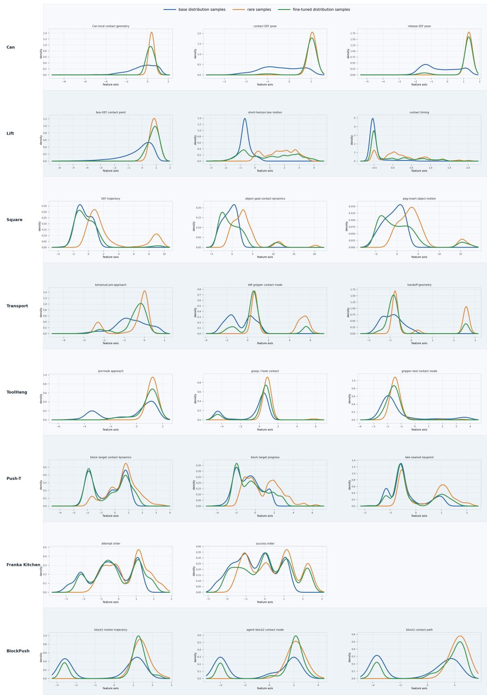  
Figure 7: Task-feature distribution-shift diagnostics across manipulation benchmarks. Each panel shows a one-dimensional Task Feature KDE for a task-related event axis. Blue curves denote rollout samples from the base diffusion policy, orange curves denote rare-sampled rollout candidates, and green curves denote rollout samples from the fine-tuned policy after adaptation. The horizontal coordinate is the base-calibrated task-feature axis, oriented so that rightward movement corresponds to the rarer side of the base-policy rollout distribution. Densities are normalized within each panel and should be interpreted as distributional overlap and shift patterns rather than as directly comparable ab solute density magnitudes across different event measures. Kitchen panels show Gaussian-smoothed KDEs of scalar embeddings of discrete attempt-order and success-order descriptors.