(a) VLA: Task-Oriented

# VLSA: Vision-Language-Action Models with Plug-and-Play Safety Constraint Layer

Songqiao Hu1,2,∗, Zeyi Liu1,2,∗, Shuang Liu1,2,3, Jun Cen4, Zihan Meng3, Shihefeng Wang1, Xiang Li1, and Xiao He1,2,†

Abstract— Vision-Language-Action (VLA) models have demonstrated remarkable capabilities in generalizing across diverse robotic manipulation tasks. However, deploying these models in unstructured environments remains challenging due to the critical need for simultaneous task compliance and safety assurance, particularly in preventing potential collisions during physical interactions. In this work, we introduce a Vision-Language-Safe Action (VLSA) architecture, named AEGIS, which contains a plug-and-play safety constraint (SC) layer formulated via control barrier functions. AEGIS integrates directly with existing VLA models to improve safety with theoretical guarantees, while maintaining their original instruction-following performance. To evaluate the efficacy of our architecture, we construct a comprehensive safety-critical benchmark SafeLIBERO, spanning distinct manipulation scenarios characterized by varying degrees of spatial complexity and obstacle intervention. Extensive experiments demonstrate the superiority of our method over state-of-the-art baselines. Notably, AEGIS achieves over 50% improvement in obstacle avoidance rate while substantially increasing the task success rate by nearly 10%. All benchmark datasets, code, and supplementary materials are publicly available at https://vlsa-aegis.github.io/.

## I. INTRODUCTION

Vision-Language-Action (VLA) models have demonstrated remarkable generalization capabilities across a wide range of robotic manipulation tasks by unifying visual encoding, language understanding, and action control into a single end-to-end framework [1]–[3]. As a key technological pathway linking semantic parsing with embodied control, VLA models enable robots to generate coherent physical actions from visual observations and natural language goals, representing a significant step toward general-purpose embodied intelligence [4]. Recent advances, such as π0.5 [5] and OpenVLA [6], have made substantial progress in spatial reasoning and multimodal alignment, enhancing reasoning efficiency and task execution performance.

Safety stands as a prerequisite for the real-world deployment of VLA models, as collisions in unstructured environments can lead to hardware damage, human injury, or property loss [7]–[9]. Although semantic understanding is well performed by existing VLA models, safety guarantees are often overlooked [2]. In recent works, safety constraints are integrated through reinforcement learning [10]–[12]. These approaches have demonstrated promising results in specific tasks. Nevertheless, these retraining-based methods require prohibitive computational costs and are further bottlenecked by the expensive, labor-intensive nature of collecting safe real-world robotic data. Furthermore, their flexibility is severely restricted when deployed with existing pretrained models [13]. Additionally, safety is typically handled as a soft objective through reward penalties rather than a hard constraint in such cases [14]. Consequently, robot behavior in unstructured environments remains overly reliant on the generalization capability of VLA models, and unsafe trajectories might be produced when out-of-distribution scenarios are encountered.

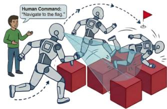

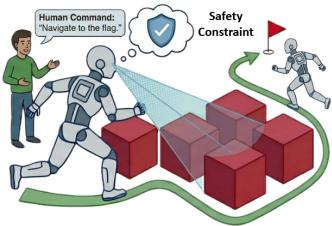  
(b) VLSA: Task-Oriented With Safety (Collision-Free)  
Fig. 1: Illustrative Comparison of VLA and VLSA Model Behaviors.

Therefore, strict physical safety must be enforced while instruction-following capabilities are maintained. However, directly integrating analytic safety filters like control barrier functions (CBFs) into end-to-end VLA models is non-trivial due to two main challenges: the modality gap between raw visual inputs and precise geometric states, and the semantic gap between language instructions and actual collision hazards [15]. Consequently, a naive integration often leads to overly conservative behaviors, such as treating necessary objects as obstacles, thereby hindering task execution.

To address these challenges, a vision-language-safe action (VLSA) architecture is introduced. As illustrated in Fig. 1, conventional VLA models are designed to execute semantic instructions. In contrast, the VLSA framework introduces a safety constraint layer that dynamically adjusts the original action to be a safe action while preserving the intended instruction. Following the structure of VLSA, we propose AEGIS (Action Execution Guarded by Invariant Safety) in this paper. Specifically, AEGIS leverages the reasoning power of vision-language models (VLMs) to identify objects in the scene that may obstruct robotic motion based on natural language instructions and visual observations By incorporating open-set object detection and depth information, semantic-level risks are translated into physical-space avoidance requirements. A CBF-based quadratic programming (QP) solver is then constructed. During inference, nominal actions generated by the VLA model are monitored in realtime. The SC layer activates only when potential safety violations are detected, thereby preserving the original task intent while enforcing mathematically proven strict safety guarantees and ensuring safe robotic operation.

Main contributions are summarized as follows:

1) We propose AEGIS, the first approach that integrates CBFs into VLA models to enforce explicit safety constraints. By introducing a plug-and-play SC layer, AEGIS bridges visual perception and semantic understanding with safety-guaranteed control, without the need for retraining.

2) We establish SafeLIBERO, a comprehensive safetycritical benchmark derived from the LIBERO dataset, encompassing 32 diverse scenarios and 1600 episodes with various types of obstacles. It provides a platform for evaluating the safety and robustness of VLA policies in complex environments.

3) Extensive simulation studies on SafeLIBERO demonstrate that AEGIS achieves superior performance to state-of-the-art baselines, yielding a more than 50% improvement in obstacle avoidance and a nearly 10% gain in task success rate. In addition, real-world robotic experiments are conducted to validate the practical applicability of the proposed framework.

## II. RELATED WORK

## A. Vision-Language-Action Models

VLA models unify visual encoding, language understanding, and action control into an end-to-end framework, enabling robots to generate coherent physical actions from visual observations and natural-language goals [1], [2], [8]. They bridge the gap between semantic interpretation and embodied control, serving as a key technological pathway toward general-purpose and highly generalizable embodied intelligence. A VLA model maps vision-language inputs to actions via a pipeline of encoding, multimodal fusion, and decoding. Recent progress in VLA research has been driven by advances in spatial reasoning, multimodal alignment, large-scale pretraining, model architecture and inference efficiency [5], [6], [16]–[19].

Despite these impressive capabilities in semantic understanding and task generalization, most existing VLA models overlook the critical aspect of safety. Consequently, direct deployment of such black-box policies in real-world environments remains risky, as they may generate erratic or unsafe trajectories when facing out-of-distribution scenarios [20]. To address the issue, recent work SafeVLA [10] has attempted to incorporate safety considerations by integrating constraints into the training process via reinforcement learning. However, such retraining-based methods require high computational costs and are difficult to apply directly to existing VLA models. Furthermore, relying solely on reinforcement learning optimization typically treats safety as a soft objective (i.e., reward penalties) rather than a hard constraint [14]. While effectively improving safety levels, these approaches lack explicit, analytic mechanisms to enforce boundary conditions during inference, leaving the robot behavior dependent on probabilistic model outputs rather than grounded physical constraints. Therefore, it is essential to explore a training-free framework that enforces explicit safety constraints during VLA inference.

## B. Safety-Guaranteed Control

Traditional approaches to robot safety typically rely on motion planning algorithms such as RRT\* [21], or reactive methods like artificial potential fields (APF) [22]. While effective in classical settings, these methods are unsuitable for VLA models, as overriding the end-to-end semantic actions with a global planner discards the model’s intent. Furthermore, these conventional methods often lack rigorous theoretical safety guarantees [23]. In contrast, CBFs have emerged as a preferred solution for robot control [24]. Acting as a safety filter and typically formulated as a optimization problem, CBFs minimally adjust the nominal action of robots to ensure the forward invariance of a safe set [25]. The mechanism strictly prevents collisions while preserving the original task behavior to the maximum extent possible.

However, as introduced earlier, integrating CBFs into VLA frameworks presents two practical challenges. First, standard CBFs depend on precise geometric states, such as obstacle positions and shapes, creating a perception gap when dealing with the raw visual inputs of VLA models [26]. Second, traditional geometric barriers are semantic-agnostic. All objects within the environment are treated indiscriminately as static obstacles without understanding the task context or assessing their specific safety levels [27], which highlights the need for a pipeline that can extract task-relevant geometric primitives from visual data to ground the CBF constraints.

## III. PROBLEM FORMULATION

Consider a robotic manipulation task where a VLA model serves as the high-level policy. Let $o _ { t }$ denote the visual observation and l be the natural language instruction. At each time step, the VLA model predicts a reference action ${ \pmb u } _ { \mathrm { v l a } } \ = \ [ { \pmb v } _ { \mathrm { v l a } } ^ { \top } , { \pmb \omega } _ { \mathrm { v l a } } ^ { \top } , g _ { \mathrm { v l a } } ] ^ { \top }$ based on the inputs, comprising the end-effector translational velocity ${ v _ { \mathrm { v l a } } }$ , rotational velocity $\omega _ { \mathrm { v l a } }$ , and gripper command ${ \mathit { g } } _ { \mathrm { v l a } }$ . However, since the raw VLA output lacks explicit guarantees for physical safety, we introduce a safety filter based on CBFs.

We model the entire end-effector assembly and taskrelevant obstacles as ellipsoids. The safety of the system is encoded by a continuously differentiable function h(x) [15], where x consists of the geometric parameters of the ellipsoids and a virtual auxiliary state. The set of safe states is defined as the superlevel set:

$$
\mathcal {C} = \{\boldsymbol {x} \mid h (\boldsymbol {x}) \geq 0 \}.\tag{1}
$$

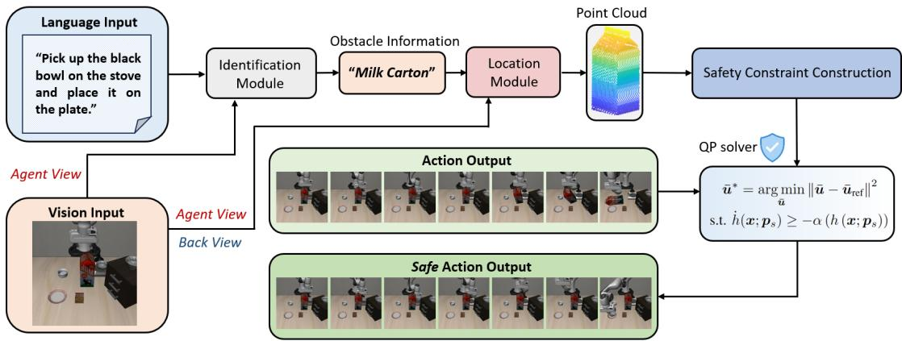  
Fig. 2: Workflow of the AEGIS model.

To strictly enforce the forward invariance of C, we formulate the control problem as a optimization problem, which seeks a safe control input $\pmb { u } _ { \mathbf { s a f e } }$ that minimally deviates from the nominal VLA reference:

$$
\begin{array}{c} \boldsymbol {u} _ {\text {safe}} = \underset {\boldsymbol {u}} {\arg \min} \left\| \boldsymbol {u} - \boldsymbol {u} _ {\text {vla}} \right\| ^ {2} \\ \text {s.t.} \dot {h} (\boldsymbol {x}) \geq - \alpha (h (\boldsymbol {x})), \end{array}\tag{2}
$$

where $\alpha ( \cdot )$ is an extended class- ${ \kappa } _ { \infty }$ function governing the convergence rate to the safe set boundary [28]. The resulting control input ${ \pmb u } _ { \mathrm { s a f e } }$ is then executed by the robot manipulator.

Our primary objective is to construct a CBF h derived from the language instruction l and visual observation $o _ { t } ,$ and to solve Eq. (2) in real-time for safety-guaranteed control.

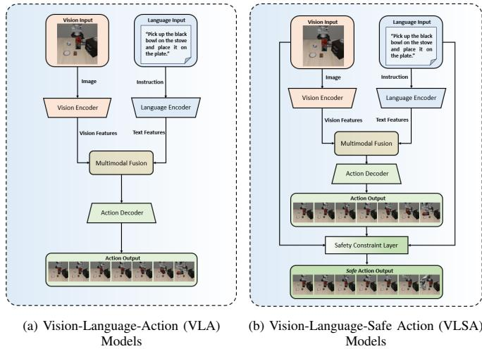  
Fig. 3: Functional architecture of VLA and VLSA models.

## IV. VLSA MODELS AND AEGIS FRAMEWORK

## A. Main Architecture

The main architectures of AEGIS and VLSA are shown in Figs. 2 and 3, respectively. Similar to most VLA architectures, VLSA uses a visual encoder, a language encoder, multimodal fusion, and an action decoder to generate actions from linguistic and visual inputs. Distinctly, as shown in Fig. 3, VLSA incorporates an additional SC layer positioned after the original VLA action output. The SC layer receives visual features, linguistic features, and the action output from the base VLA model. While conventional VLA models emphasize task completion, they typically overlook safety considerations during execution. In contrast, the SC layer modifies potentially unsafe actions into safe alternatives. If no safety risks are identified, the SC layer output remains identical to the original VLA output, thereby maintaining the model’s baseline performance.

To achieve this, AEGIS implements the SC layer by integrating two interconnected modules: a vision-languagebased safety assessment module and an action-driven safetyguaranteed control module. As illustrated in Fig. 2, the safety assessment module first processes linguistic instructions and visual observations to semantically identify and spatially localize the most critical obstacle in the 3D workspace. This refined spatial information is then fed into the safetyguaranteed control module, which models the collision geometry and leverages a CBF approach to correct potentially unsafe actions via a convex QP solver. The detailed formulations of these two modules are presented in Section IV-B and Section IV-C, respectively.

## B. Vision-Language-based Safety Assessment Module

Safety assessment is foundational for synthesizing safe actions [29], [30]. As shown in Fig. 4, our vision-languagebased module identifies and localizes potential obstacles that may interfere with the robot in two main stages: semanticlevel identification and precise spatial localization.

In the first stage, a VLM infers potential obstacles by jointly processing a natural language task instruction (e.g., “Pick up the black bowl...”) and an agent-view RGB image. To ensure consistent reasoning, the VLM is explicitly prompted to identify the single most critical non-robot obstacle. The constrained output must contain only a uniquely identifiable obstacle name, including its color and type, preferably selected from a predefined list.

The VLM subsequently outputs a concise, uniquely identifiable object name (e.g., “Red milk carton”), which directly serves as a textual grounding query for spatial localization. To achieve this, we employ GroundingDINO [31] to process the RGB image alongside the textual query, generating candidate 2D bounding boxes for the identified obstacle. To ensure reliable localization, only the bounding box with the highest confidence score is retained for the 3D projection.

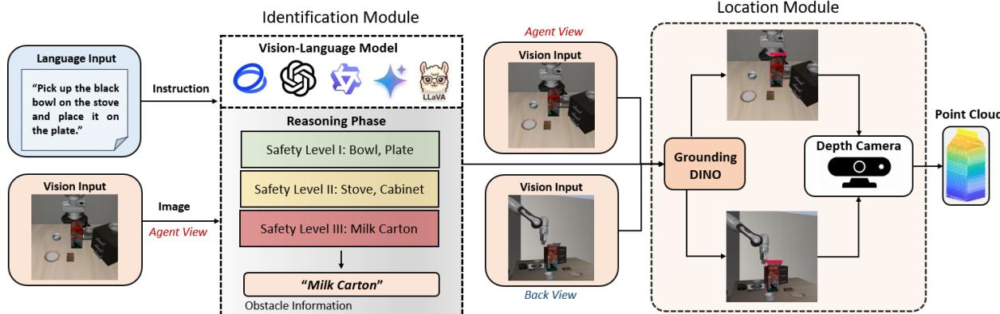  
Fig. 4: Pipeline of the vision-language-based safety assessment module.

Subsequently, the spatial region corresponding to the selected 2D bounding box is back-projected into 3D space. To obtain a dense and complete 3D representation of the obstacle, we fuse the local point clouds generated from both the agent-view camera and an auxiliary back-view depth sensor. This fusion requires aligning the data into a unified world coordinate system using the standard camera projection model:

$$
\left[ \begin{array}{c} X \\ Y \\ Z \\ 1 \end{array} \right] = T _ {\mathrm{cam}} ^ {\mathrm{world}} \cdot \left[ \begin{array}{c} K ^ {- 1} \cdot d \cdot \left[ \begin{array}{c} u \\ v \\ 1 \end{array} \right] \\ 1 \end{array} \right]\tag{3}
$$

where $( u , v )$ denote the pixel coordinates, d is the depth value, K is the camera intrinsic matrix, and $T _ { \mathrm { c a m } } ^ { \mathrm { w o r l d } }$ represents the extrinsic transformation from the camera frame to the world frame.

To ensure the reliability of the downstream control module, a rigorous preprocessing pipeline is applied to the fused point cloud. We first impose predefined workspace bounds to filter out irrelevant background points. Next, distance-based outlier removal is performed by discarding the farthest 20% of points relative to the data centroid. Finally, a clustering operation [32] isolates the most populous cluster, effectively extracting the main obstacle body.

## C. Action-driven Safety-guaranteed Control Module

To represent the safety threat efficiently, we adopt a minimum volume enclosing ellipsoid (MVEE) to enclose the processed obstacle point cloud $\{ { \pmb x } _ { i } \} _ { i = 1 } ^ { n }$ . The obstacle ellipsoid $\mathcal { E } _ { o b }$ is defined as:

$$
\mathcal {E} _ {o b} = \left\{\boldsymbol {x} \in \mathbb {R} ^ {d} \mid (\boldsymbol {x} - \boldsymbol {c}) ^ {\top} \boldsymbol {R} ^ {\top} \boldsymbol {Q} \boldsymbol {R} (\boldsymbol {x} - \boldsymbol {c}) \leq 1 \right\},\tag{4}
$$

where $c \in \mathbb { R } ^ { d }$ is the center, $R \in \mathrm { S O } ( d )$ is the orientation matrix, and $Q \ \succ \ 0$ determines the shape and size. The optimal parameters are obtained by solving the following optimization problem, where minimizing − log det(Q) inherently minimizes the ellipsoid volume:

$$
\begin{array}{l l} & \underset {\boldsymbol {Q} \succ 0, \boldsymbol {c}, \boldsymbol {R} \in \mathrm{SO} (d)} {\min} - \log \det (\boldsymbol {Q}) \\ s. t. & \left[ \begin{array}{c c} \boldsymbol {Q} & \boldsymbol {R} (\boldsymbol {x} _ {i} - \boldsymbol {c}) \\ (\boldsymbol {R} (\boldsymbol {x} _ {i} - \boldsymbol {c})) ^ {\top} & 1 \end{array} \right] \succeq 0, i = 1, \ldots , n \\ & \boldsymbol {R} ^ {\top} \boldsymbol {R} = \boldsymbol {I}, \quad \det (\boldsymbol {R}) = 1. \end{array}\tag{5}
$$

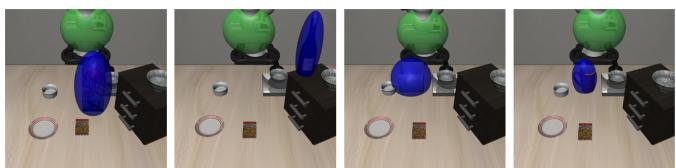  
Fig. 5: MVEE fitting for the end-effector and the obstacle.

Similarly, we model the robot’s end-effector as an ellipsoid $\mathcal { E } _ { e f }$ with a fixed size matrix $Q _ { e f }$ . Let $p _ { e f }$ and $R _ { e f }$ denote the position and rotation matrix of the end-effector, respectively. With a constant structural offset $\Delta p ,$ , the ellipsoid center $p _ { e p }$ is rigidly attached to the end-effector kinematics:

$$
\boldsymbol {p} _ {e p} = \boldsymbol {p} _ {e f} + \boldsymbol {R} _ {e f} \Delta \boldsymbol {p}.\tag{6}
$$

To formulate the collision avoidance dynamics, we define an augmented state vector ${ \pmb x } = [ { p _ { e p } } , { R _ { e f } } , { p _ { s } } ]$ . Here, $\pmb { p } _ { s }$ is a virtual auxiliary state on the unit sphere, mapping to a point ${ \pmb p } _ { b }$ on the surface of $\mathcal { E } _ { e f }$ via:

$$
\boldsymbol {p} _ {b} = \bar {\boldsymbol {Q}} _ {e f} \boldsymbol {p} _ {s} + \boldsymbol {p} _ {e p},\tag{7}
$$

where $\bar { Q } _ { e f } = R _ { e f } Q _ { e f } R _ { e f } ^ { \top }$ . The tangent plane $\tau$ at ${ \pmb p } _ { b }$ is then given by:

$$
\mathcal {T} = \left\{\boldsymbol {q} \in \mathbb {R} ^ {d} \mid \boldsymbol {p} _ {e f} ^ {\top} \bar {\boldsymbol {Q}} _ {e f} ^ {- 1} \boldsymbol {q} - \left(1 + \boldsymbol {p} _ {e f} ^ {\top} \bar {\boldsymbol {Q}} _ {e f} ^ {- 1} \boldsymbol {p} _ {e f}\right) = 0 \right\}.\tag{8}
$$

Assuming $\tau$ initially separates the two ellipsoids, the signed distance $h ( { \pmb x } )$ from the obstacle ellipsoid $\mathcal { E } _ { o b }$ to $\tau$ is derived as:

$$
h (\boldsymbol {x}) = \frac {- \left\| \bar {\boldsymbol {Q}} _ {o b} \bar {\boldsymbol {Q}} _ {e f} ^ {- 1} \boldsymbol {p} _ {s} \right\| + \left(\boldsymbol {p} _ {o b} - \boldsymbol {p} _ {e f}\right) ^ {\top} \bar {\boldsymbol {Q}} _ {e f} ^ {- 1} \boldsymbol {p} _ {s} - 1}{\left\| \bar {\boldsymbol {Q}} _ {e f} ^ {- 1} \boldsymbol {p} _ {s} \right\|}.\tag{9}
$$

By maximizing h over $\mathbf { \Delta } _ { p _ { s } , }$ we obtain the shortest distance between the two ellipsoids. This formulation allows $h ( { \pmb x } )$ to serve as a valid CBF [33]. By dynamically controlling the virtual state $\pmb { p } _ { s }$ , the conservativeness of the avoidance will be reduced. The nominal VLA actions are subsequently adjusted into safe control commands via the QP in Eq. (2). The theoretical safety guarantee is established in Theorem 1.

Theorem 1: Assuming accurate safety assessment, precise point cloud filtering, and complete obstacle representation such that the two generated MVEEs strictly enclose the obstacle and the robot end-effector respectively, the AEGIS framework guarantees that the entire robot end-effector will not collide with the obstacle.

Proof: According to [33], the function h defined in Eq. (9) constitutes a valid CBF that characterizes the safe superlevel set ${ \mathcal { C } } = \{ { \pmb x } \ | \ h ( { \pmb x } ) \ge 0 \}$ , where any augmented state $\pmb { x } \in \mathcal { C }$ corresponds to a collision-free configuration between the robot end-effector and the obstacle. Given that the system initializes in a safe configuration $( \mathrm { i . e . , } h ( \pmb { x } ( t _ { 0 } ) ) > 0 )$ the QP solver strictly enforces the differential constraint ${ \dot { h } } \geq$ $- \alpha ( h )$ . By Nagumo’s Theorem [34], this condition ensures the forward invariance of C, implying $h ( { \pmb x } ( t ) ) \geq 0$ and thus $\pmb { x } ( t ) \in \mathcal { C }$ for all $t \geq t _ { 0 }$ . Geometrically, this guarantees that the intersection of the proxy ellipsoids remains empty, i.e., $\mathcal { E } _ { e f } \cap \mathcal { E } _ { o b } = \emptyset$ . Furthermore, based on the strict constraint Eq. (5) where the robot end-effector $\mathcal { A } _ { e f }$ and the obstacle $\mathcal { O } _ { o b }$ satisfy $\mathcal { A } _ { e f } \subseteq \mathcal { E } _ { e f }$ and $\mathcal { O } _ { o b } \subseteq \mathcal { E } _ { o b } .$ , the disjointness of the supersets necessitates the disjointness of their subsets: $\mathcal { A } _ { e f } \cap \mathcal { O } _ { o b } \subseteq \mathcal { E } _ { e f } \cap \mathcal { E } _ { o b } = \emptyset$ . Consequently, the physical robot end-effector is guaranteed to remain collision-free.

## V. SIMULATION STUDIES

## A. Setup

Benchmark. The original LIBERO benchmark [35] lacks safety-critical scenarios, as objects rarely collide with the robot arm during movement. Therefore, we introduce SafeLIBERO, a comprehensive benchmark for evaluating safety-aware manipulation in complex environments. We select 16 tasks across four LIBERO suites (Spatial, Object, Goal, Long) and introduce a diverse set of everyday objects as obstacles to create two safety-critical scenarios per task: Level I (obstacles placed near the target object) and Level II (obstacles placed directly obstructing the movement path). We randomize object poses across 50 episodes per scenario, resulting in 32 unique scenarios and 1,600 total episodes. The benchmark tasks are illustrated in Fig. 6.

Baselines. We utilize the state-of-the-art flow-matching VLA model, $\pi _ { 0 . 5 } – \mathrm { L I B E R O }$ [5], as our base policy. We compare against the base $\pi _ { 0 . 5 }$ policy to quantify the direct safety improvements of our plug-and-play module, and against OpenVLA-OFT [36], a transformer-based VLA adapted via online fine-tuning, to provide a robust cross-architectural baseline. All models are evaluated under identical conditions.

Evaluation Metrics. We evaluate performance using three metrics: (1) Collision Avoidance Rate (CAR): the percentage of strictly collision-free episodes; (2) Task Success Rate (TSR): the percentage of tasks successfully completed within the time limit, noting that collisions do not trigger early termination; and (3) Execution Time Steps (ETS): the average episode length (including timeouts), where lower values indicate higher efficiency and fewer futile interactions.

Pick up the orange juice and place it in the baske  
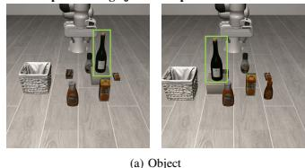

Put the bowl on top of the cabinet  
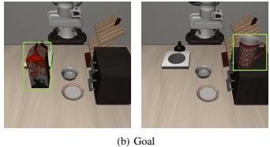

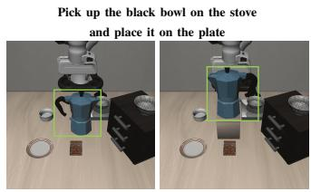

Put the white mug on the left plate and put the yellow and white mug on the right plate  
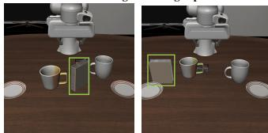  
Fig. 6: Overview of SafeLIBERO benchmark tasks.

Settings. We utilize a Franka Emika Panda robot manipulator controlled via the OSC POSE interface provided by Robosuite [37], operating at 20 Hz. To provide a comprehensive evaluation, simulation studies are conducted under both translational-only and full action-space settings. The translational setting is explicitly considered because SafeLIBERO tasks predominantly involve top-down manipulation. This configuration reduces action redundancy and enables a focused assessment of positional collision-avoidance performance. In this case, the system dynamics are simplified to the translational kinematic model $\dot { p } = 0 . 2 u$ , where p denotes the end-effector position and u is the translational action command. In the full action-space setting, both translational and rotational dynamics are incorporated. The system dynamics are described by $\dot { p } = 0 . 2 u _ { 1 : 3 }$ and $\dot { \pmb \theta } = 0 . 2 { \pmb u } _ { 4 : 6 }$ , where θ denotes the end-effector orientation and $\pmb { u } _ { 1 : 6 }$ corresponds to the six-dimensional action command. Geometrically, the endeffector is approximated as an MVEE with a size matrix $Q _ { e f } ~ = ~ \mathrm { d i a g } ( 0 . 0 6 , 0 . 1 2 , 0 . 1 1 )$ meters. For safety control, the CBF class-K∞ function is set to $\alpha ( h ) ~ = ~ 1 0 h$ with a reference control coefficient $k = 1 0$ . We employ GLM-4.5V [38] for vision-language safety assessment. Maximum episode horizons are 300 steps for the Spatial, Goal, and Object suites, and 550 for the Long suite.

## B. Results

1) Performance Analysis: Table I presents the quantitative comparison on SafeLIBERO, with more detailed results provided in the supplementary materials1. AEGIS shows significant superiority in both safety and task execution.

Most notably, AEGIS achieves a fourfold increase in the CAR, reaching 77.9% / 68.9% (translational / full action space) compared to the base $\pi _ { 0 . 5 }$ (18.7% / 17.1%) and OpenVLA-OFT (15.1% / 5.7%). Importantly, our results indicate that safety is a prerequisite for success in cluttered environments. Baselines frequently suffer from cascading failures—such as knocking over obstacles that subsequently occlude the target objects, particularly in the Level I Object suite. By strictly preventing these disruptive collisions, AEGIS preserves workspace integrity and achieves the highest TSR of 68.1% / 67.5%, significantly outperforming π0.5 (50.9% / 57.8%). Furthermore, AEGIS records the lowest ETS, proving that the safety layer avoids unnecessary extra movements and prevents the robot from getting stuck on obstacles, which frequently slows down the baselines.

TABLE I: Quantitative results on the SafeLIBERO benchmark.

<table><tr><td rowspan="3">Task</td><td colspan="9">Translational Action Space Only</td><td colspan="8">Full Action Space</td><td></td></tr><tr><td colspan="3"> $OpenVLA-OFT_t$ </td><td colspan="3"> $\pi_{0.5,t}$ </td><td colspan="3"> $Ours_t$ </td><td colspan="3"> $OpenVLA-OFT$ </td><td colspan="3"> $\pi_{0.5}$ </td><td colspan="3">Ours</td></tr><tr><td>CAR↑</td><td>TSR↑</td><td>ETS↓</td><td>CAR↑</td><td>TSR↑</td><td>ETS↓</td><td>CAR↑</td><td>TSR↑</td><td>ETS↓</td><td>CAR↑</td><td>TSR↑</td><td>ETS↓</td><td>CAR↑</td><td>TSR↑</td><td>ETS↓</td><td>CAR↑</td><td>TSR↑</td><td>ETS↓</td></tr><tr><td>Spatial</td><td>12.8%</td><td>35.8%</td><td>238.1</td><td>15.3%</td><td>59.8%</td><td>201.7</td><td>75.5%</td><td>73.3%</td><td>188.2</td><td>8.3%</td><td>36.5%</td><td>235.1</td><td>14.0%</td><td>59.3%</td><td>199.5</td><td>68.0%</td><td>68.5%</td><td>194.9</td></tr><tr><td>Goal</td><td>25.0%</td><td>22.5%</td><td>255.6</td><td>23.8%</td><td>54.3%</td><td>210.3</td><td>81.5%</td><td>75.3%</td><td>179.6</td><td>19.5%</td><td>24.3%</td><td>249.0</td><td>20.0%</td><td>60.0%</td><td>199.7</td><td>76.5%</td><td>82.8%</td><td>166.3</td></tr><tr><td>Object</td><td>17.3%</td><td>29.5%</td><td>257.4</td><td>23.0%</td><td>53.8%</td><td>223.0</td><td>74.8%</td><td>80.3%</td><td>201.3</td><td>11.5%</td><td>28.8%</td><td>259.9</td><td>18.0%</td><td>57.5%</td><td>223.5</td><td>71.3%</td><td>72.5%</td><td>214.2</td></tr><tr><td>Long</td><td>5.5%</td><td>3.5%</td><td>541.5</td><td>12.8%</td><td>35.8%</td><td>478.0</td><td>79.6%</td><td>43.8%</td><td>480.1</td><td>6.0%</td><td>15.3%</td><td>511.7</td><td>16.5%</td><td>54.3%</td><td>420.5</td><td>59.8%</td><td>46.3%</td><td>455.1</td></tr><tr><td>Average</td><td>15.1%</td><td>22.8%</td><td>323.2</td><td>18.7%</td><td>50.9%</td><td>278.2</td><td>77.9%</td><td>68.1%</td><td>262.3</td><td>5.7%</td><td>26.2%</td><td>313.9</td><td>17.1%</td><td>57.8%</td><td>260.8</td><td>68.9%</td><td>67.5%</td><td>257.6</td></tr></table>

Notes: subscript t denotes policies with translational action space only. CAR: Collision Avoidance Rate; TSR: Task Success Rate; ETS: Executio Time Steps. Best results are highlighted in bold.

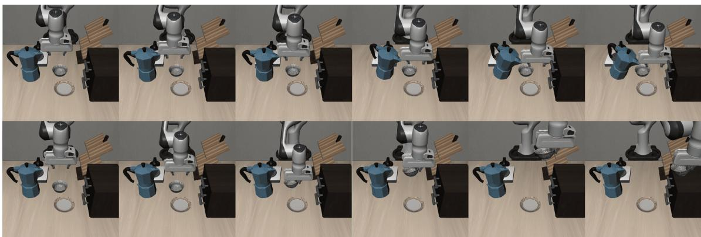  
Fig. 7: Visual comparison of task execution processes. The task instruction is “Put the bowl on top of the cabinet.” Top row: The baseline policy π0.5 blindly executes nominal actions, resulting in collisions and task failure. Bottom row: AEGIS dynamically generates collision-free actions to achieve task success. For more qualitative results across other task suites, please refer to the supplementary video.

2) Behavioral and Constraint Analysis: Qualitative Visualization. As shown in Fig. 7, baseline policies blindly execute nominal actions, resulting in direct collisions that physically destabilize the environment. In contrast, AEGIS dynamically generates collision-free actions across diverse obstacle geometries while maintaining goal progression. It highlights the effectiveness of our QP formulation, which optimally minimizes deviation from the original VLA action subject to strict safety bounds.

Constraint Evolution. To verify the theoretical validity of our safety layer, Fig. 8 tracks the temporal evolution of the CBF value, h(x). As the robot approaches an obstacle, h(x) decreases but consistently remains strictly positive. This empirical evidence confirms that the control solver successfully enforces the forward invariance condition $\dot { h } \ge - \alpha ( h )$ at every time step, reliably translating semantic perception into physical safety.

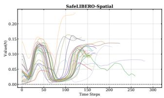  
(a) Spatial

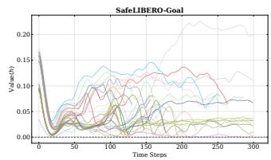  
(b) Goal

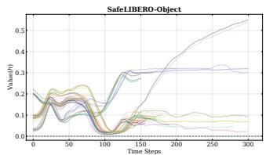  
(c) Object

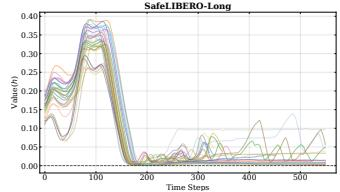  
(d) Long  
Fig. 8: Constraint evolution analysis. Note that in single-column mode, ensure axis labels are legible.

Time Complexity. The underlying SC layer formulates a convex QP with a single linear constraint, effectively acting as a lightweight piecewise intervention that only modifies unsafe nominal actions. As shown in Fig. 10, the SC layer incurs a negligible computation time of merely 0.356 ms per step on an RTX 4090 GPU setup. This accounts for approximately 1.86% of the total cycle latency (roughly 1/47 of the VLA inference time), ensuring the control loop maintains a 20 Hz real-time execution frequency.

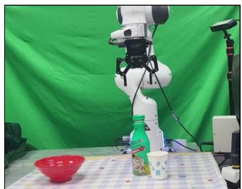  
Task: Put the cup in the bowl.  
(a) Level I

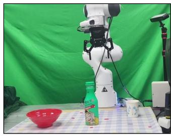  
(b) Level II  
Task: Put the apple in the basket.

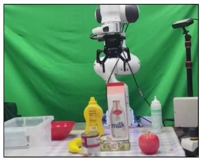  
(c) Level I

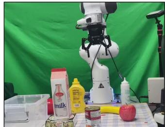  
(d) Level II

Fig. 9: Real-world Experiments. The platform consists of a 7-DoF Franka Emika Panda arm operated in joint velocity control mode, equipped with a Robotiq 2F-85 gripper. Perception is provided by an external ZED 2 stereo camera and a wrist-mounted ZED Mini stereo camera. The VLA policy infers at 15 Hz, while the low-level controller runs at 1 kHz. Experiments encompass two distinct tasks, each evaluated across two levels with varying obstacles  
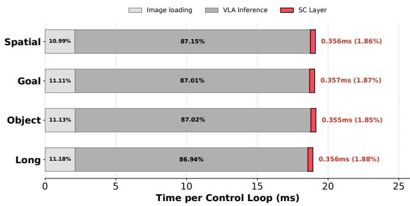  
Fig. 10: Time complexity analysis of the proposed approach. SC layer imposes a minimal computational burden $( \bar { < } 2 \bar { \% }$ of the total cycle time).

## C. Discussion and Limitations

Why is 100% CAR not Achieved? Ideally, AEGIS guarantees complete collision avoidance for the end-effector. However, residual collisions occur in practice due to limitations in the upstream perception pipeline rather than the control logic. These failures primarily stem from obstacle misidentification, inaccurate spatial grounding, or aggressive point cloud filtering that underestimates the obstacle’s geometry. Furthermore, because our current formulation solely constrains the end-effector, unconstrained kinematic links may occasionally collide

Safety-Induced Distribution Shift. We observe that although the robot can successfully avoid obstacles, it may subsequently fail to complete the task due to distribution shift. Specifically, enforcing safety with AEGIS can drive the system into out-of-distribution states (e.g., higher altitudes rarely seen in the base VLA training data), where the policy may behave erratically and fail to recover toward the goal. Future work should therefore expand training data to better cover these safety-induced out-of-distribution regions.

## VI. REAL-WORLD EXPERIMENTS

To validate the real-world applicability and robustness of our proposed framework, we construct a physical robot platform as shown in Fig. 9. We utilize $\pi _ { 0 . 5 } – \mathrm { D R O I D }$ as our base VLA policy. Since our hardware configuration is consistent with that used for DROID dataset collection [39], we deploy $\pi _ { 0 . 5 } – \mathrm { D R O I D }$ in a zero-shot manner without finetuning. To align with the simulation studies, we set up two tasks, each comprising two safety levels, as illustrated in Fig. 9. In all tasks, the robot is required to accomplish the assigned objective while avoiding collisions.

A comparative evaluation with the $\pi _ { 0 . 5 } – \mathrm { D R O I D }$ policy is conducted, and the results are presented in the supplementary video. In these scenarios, the $\pi _ { 0 . 5 } – \mathrm { D R O I D }$ policy directly collides with the predefined obstacles. In contrast, the proposed method successfully identifies obstacles and leverages point clouds acquired from the external camera to construct CBFs. The nominal actions are subsequently modified to ensure safety, yielding performance that is consistent with the results observed in simulation.

## VII. CONCLUSION

In this work, a novel AEGIS approach, following VLSA architecture, was designed to bridge the gap between semantic instruction following and physical safety in robotic manipulation. By introducing a plug-and-play SC layer formulated via CBFs, our approach enables existing VLA models to enforce strict safety boundaries with theoretical guarantees without compromising their original task capabilities. We validated our method on the constructed SafeLIBERO benchmark, which covers 32 distinct scenarios with varying spatial complexities. In addition, similar experiments were conducted on a real robotic platform to assess practical applicability. Our extensive experiments demonstrate that VLSA significantly outperforms state-of-the-art baselines. It is noteworthy that highly dynamic obstacles and complex whole-body collision avoidance substantially impose stricter safety requirements. Addressing these challenges and extending VLSA to achieve safer and more efficient performance constitute important and compelling directions for future research, and remain part of our ongoing work.

## ACKNOWLEDGMENT

The authors thank Xingyu Liu, Yongyi Jia, and Junjie Ding from Tsinghua University for their helpful discussions and support. The authors also acknowledge the use of large language models (e.g., Gemini) for assisting in visualizing concepts and improving the clarity of the manuscript.

## REFERENCES

[1] B. Zitkovich, T. Yu, S. Xu, P. Xu, T. Xiao, F. Xia et al., “Rt-2: Visionlanguage-action models transfer web knowledge to robotic control,” in Proceedings of The 7th Conference on Robot Learning, vol. 229. PMLR, 2023, pp. 2165–2183.

[2] R. Sapkota, Y. Cao, K. I. Roumeliotis, and M. Karkee, “Visionlanguage-action models: Concepts, progress, applications and challenges,” arXiv preprint arXiv:2505.04769, 2025.

[3] K. Kawaharazuka, J. Oh, J. Yamada, I. Posner, and Y. Zhu, “Visionlanguage-action models for robotics: A review towards real-world applications,” IEEE Access, 2025.

[4] H. Song, L. Wang, X. Qiao, Y. Chen, D. Sun, and Z. Sun, “Embodied intelligence for robot manipulation: development and challenges,” Vicinagearth, vol. 2, no. 1, p. 8, 2025.

[5] K. Black, N. Brown, J. Darpinian, K. Dhabalia, D. Driess, A. Esmail, M. R. Equi, C. Finn, N. Fusai, M. Y. Galliker et al., “π0.5: a visionlanguage-action model with open-world generalization,” in Proceedings of The 9th Conference on Robot Learning, vol. 305. PMLR, 2025, pp. 17–40.

[6] M. J. Kim, K. Pertsch, S. Karamcheti, T. Xiao, A. Balakrishna, S. Nair et al., “Openvla: An open-source vision-language-action model,” arXiv preprint arXiv:2406.09246, 2024.

[7] Z. Liu, S. Hu, and X. He, “Real-time safety assessment of dynamic systems in non-stationary environments: A review of methods and techniques,” in 2023 CAA Symposium on Fault Detection, Supervision and Safety for Technical Processes (SAFEPROCESS). IEEE, 2023, pp. 1–6.

[8] Y. Zhong, F. Bai, S. Cai, X. Huang, Z. Chen, X. Zhang et al., “A survey on vision-language-action models: An action tokenization perspective,” arXiv preprint arXiv:2507.01925, 2025.

[9] Z. Liu and X. He, “Dynamic submodular-based learning strategy in imbalanced drifting streams for real-time safety assessment in nonstationary environments,” IEEE Transactions on Neural Networks and Learning Systems, vol. 35, no. 3, pp. 3038–3051, 2023.

[10] B. Zhang, Y. Zhang, J. Ji, Y. Lei, J. Dai, Y. Chen, and Y. Yang, “SafeVLA: Towards safety alignment of vision-language-action model via constrained learning,” in The Thirty-ninth Annual Conference on Neural Information Processing Systems, 2025.

[11] S. Gu, L. Yang, Y. Du, G. Chen, F. Walter, J. Wang, and A. Knoll, “A review of safe reinforcement learning: Methods, theories and applications,” IEEE Transactions on Pattern Analysis and Machine Intelligence, vol. 46, no. 12, pp. 11 216–11 235, 2024.

[12] L. Brunke, M. Greeff, A. W. Hall, Z. Yuan, S. Zhou, J. Panerati, and A. P. Schoellig, “Safe learning in robotics: From learning-based control to safe reinforcement learning,” Annual Review of Control, Robotics, and Autonomous Systems, vol. 5, no. 1, pp. 411–444, 2022.

[13] E. J. Hu, Y. Shen, P. Wallis, Z. Allen-Zhu, Y. Li, S. Wang et al., “Lora: Low-rank adaptation of large language models.” in Proceedings of the International Conference on Learning Representations, vol. 1, no. 2, 2022, p. 3.

[14] A. HasanzadeZonuzy, A. Bura, D. Kalathil, and S. Shakkottai, “Learning with safety constraints: Sample complexity of reinforcement learning for constrained mdps,” in Proceedings of the AAAI Conference on Artificial Intelligence, vol. 35, no. 9, 2021, pp. 7667–7674.

[15] A. D. Ames, S. Coogan, M. Egerstedt, G. Notomista, K. Sreenath, and P. Tabuada, “Control barrier functions: Theory and applications,” in 2019 18th European control conference (ECC). IEEE, 2019, pp. 3420–3431.

[16] X. Li, L. Heng, J. Liu, Y. Shen, C. Gu, Z. Liu et al., “3ds-vla: A 3d spatial-aware vision language action model for robust multi-task manipulation,” in Proceedings of The 9th Annual Conference on Robot Learning, 2025.

[17] Z. Zhou, Y. Zhu, M. Zhu, J. Wen, N. Liu, Z. Xu et al., “Chatvla: Unified multimodal understanding and robot control with visionlanguage-action model,” in Proceedings of the 2025 Conference on Empirical Methods in Natural Language Processing, 2025, pp. 5377– 5395.

[18] M. Ge, K. Ohtani, Y. Niu, Y. Zhang, and K. Takeda, “VLA-MP: A vision-language-action framework for multimodal perception and physics-constrained action generation in autonomous driving,” Sensors, vol. 25, no. 19, p. 6163, 2025.

[19] K. Black, N. Brown, D. Driess, A. Esmail, M. Equi, C. Finn et al., “π0: A vision-language-action flow model for general robot control,” arXiv preprint arXiv:2410.24164, 2024.

[20] C. Neary, O. G. Younis, A. Kuramshin, O. Aslan, and G. Berseth, “Improving pre-trained vision-language-action policies with modelbased search,” arXiv preprint arXiv:2508.12211, 2025.

[21] S. Karaman and E. Frazzoli, “Sampling-based algorithms for optimal motion planning,” The International Journal of Robotics Research, vol. 30, no. 7, pp. 846–894, 2011.

[22] O. Khatib, “Real-time obstacle avoidance for manipulators and mobile robots,” The International Journal of Robotics Research, vol. 5, no. 1, pp. 90–98, 1986.

[23] A. Singletary, K. Klingebiel, J. Bourne, A. Browning, P. Tokumaru, and A. Ames, “Comparative analysis of control barrier functions and artificial potential fields for obstacle avoidance,” in 2021 IEEE/RSJ International Conference on Intelligent Robots and Systems (IROS). IEEE, 2021, pp. 8129–8136.

[24] W. Xiao, T.-H. Wang, R. Hasani, M. Chahine, A. Amini, X. Li, and D. Rus, “Barriernet: Differentiable control barrier functions for learning of safe robot control,” IEEE Transactions on Robotics, vol. 39, no. 3, pp. 2289–2307, 2023.

[25] L. Knoedler, O. So, J. Yin, M. Black, Z. Serlin, P. Tsiotras et al., “Safety on the fly: Constructing robust safety filters via policy control barrier functions at runtime,” IEEE Robotics and Automation Letters, 2025.

[26] S. Liu, Y. Mao, and C. A. Belta, “Safety-critical planning and control for dynamic obstacle avoidance using control barrier functions,” in 2025 American Control Conference (ACC). IEEE, 2025, pp. 348– 354.

[27] M. Srinivasan, A. Dabholkar, S. Coogan, and P. A. Vela, “Synthesis of control barrier functions using a supervised machine learning approach,” in 2020 IEEE/RSJ International Conference on Intelligent Robots and Systems (IROS). Ieee, 2020, pp. 7139–7145.

[28] P. G. Drazin, Nonlinear systems. Cambridge University Press, 1992, no. 10.

[29] Z. Liu and X. He, “Online dynamic hybrid broad learning system for real-time safety assessment of dynamic systems,” IEEE Transactions on Knowledge and Data Engineering, vol. 36, no. 12, pp. 8928–8938, 2024.

[30] S. Hu, Z. Liu, M. Li, and X. He, “CADM+: Confusion-based learning framework with drift detection and adaptation for real-time safety assessment,” IEEE Transactions on Neural Networks and Learning Systems, vol. 36, no. 3, pp. 5126–5139, 2024.

[31] S. Liu, Z. Zeng, T. Ren, F. Li, H. Zhang, J. Yang et al., “Grounding dino: Marrying dino with grounded pre-training for open-set object detection,” in European Conference on Computer Vision. Springer, 2024, pp. 38–55.

[32] K. Khan, S. U. Rehman, K. Aziz, S. Fong, and S. Sarasvady, “DB-SCAN: Past, present and future,” in The fifth international conference on the applications of digital information and web technologies (ICADIWT 2014). IEEE, 2014, pp. 232–238.

[33] R. Funada, K. Nishimoto, T. Ibuki, and M. Sampei, “Collision avoidance for ellipsoidal rigid bodies with control barrier functions designed from rotating supporting hyperplanes,” IEEE Transactions on Control Systems Technology, 2024.

[34] F. Blanchini, “Set invariance in control,” Automatica, vol. 35, no. 11, pp. 1747–1767, 1999.

[35] B. Liu, Y. Zhu, C. Gao, Y. Feng, Q. Liu, Y. Zhu, and P. Stone, “Libero: Benchmarking knowledge transfer for lifelong robot learning,” Advances in Neural Information Processing Systems, vol. 36, pp. 44 776–44 791, 2023.

[36] M. J. Kim, C. Finn, and P. Liang, “Fine-tuning vision-languageaction models: Optimizing speed and success,” arXiv preprint arXiv:2502.19645, 2025.

[37] Y. Zhu, J. Wong, A. Mandlekar, R. Mart´ın-Mart´ın, A. Joshi, S. Nasiriany, and Y. Zhu, “robosuite: A modular simulation framework and benchmark for robot learning,” arXiv preprint arXiv:2009.12293, 2020.

[38] T. GLM, A. Zeng, B. Xu, B. Wang, C. Zhang, D. Yin et al., “Chatglm: A family of large language models from glm-130b to glm-4 all tools,” arXiv preprint arXiv:2406.12793, 2024.

[39] A. Khazatsky, K. Pertsch, S. Nair, A. Balakrishna, S. Dasari, S. Karamcheti et al., “Droid: A large-scale in-the-wild robot manipulation dataset,” in Robotics: Science and Systems, 2024.